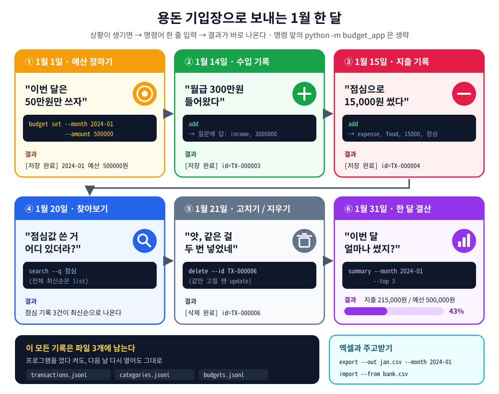
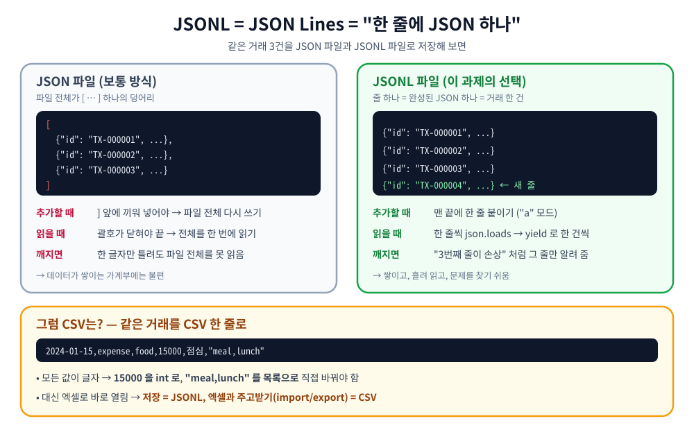
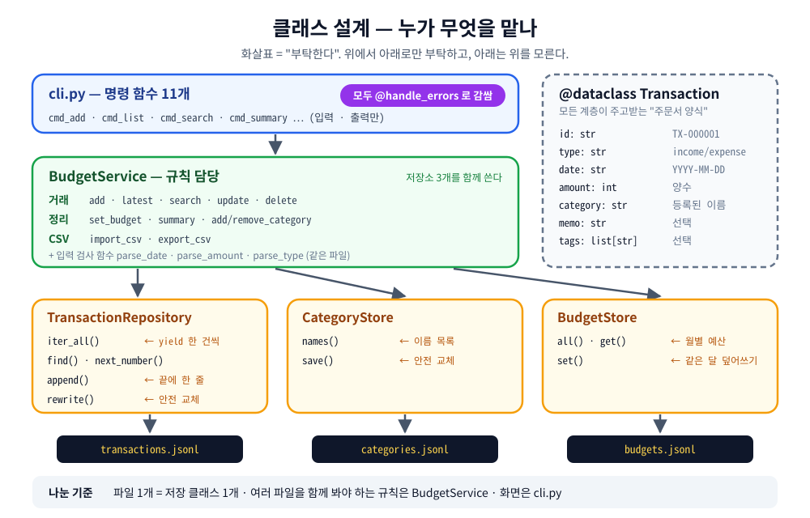
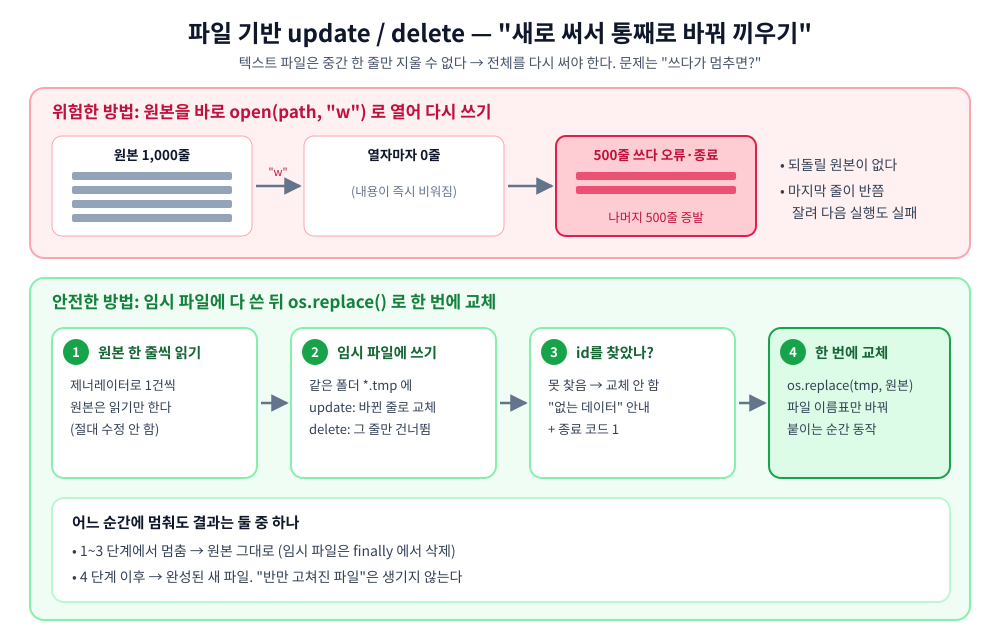
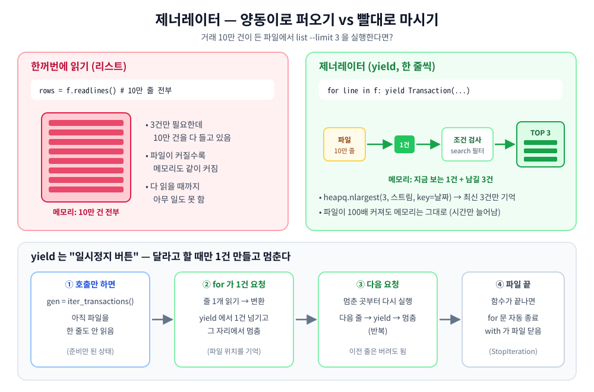
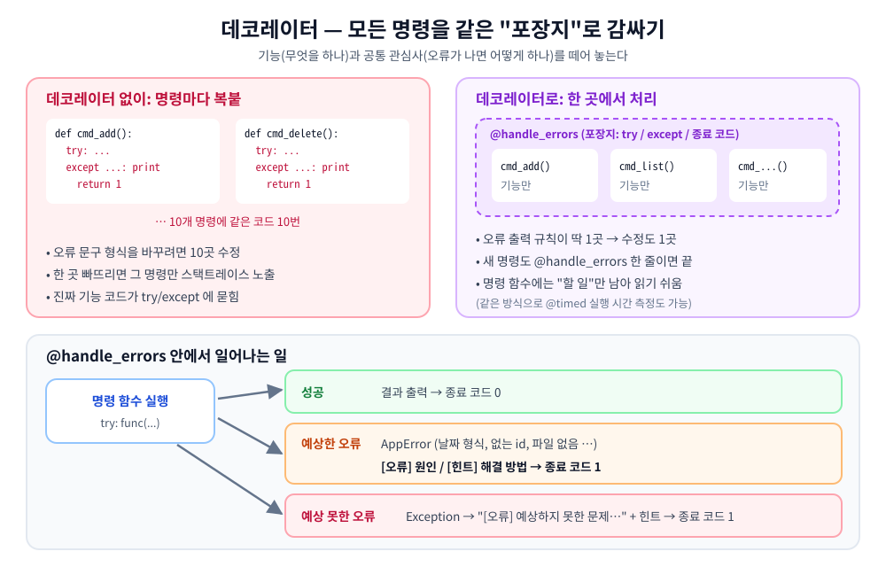
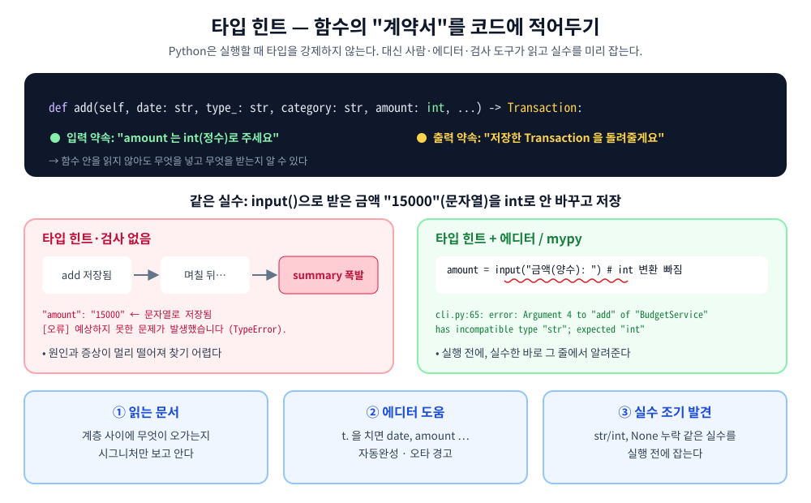
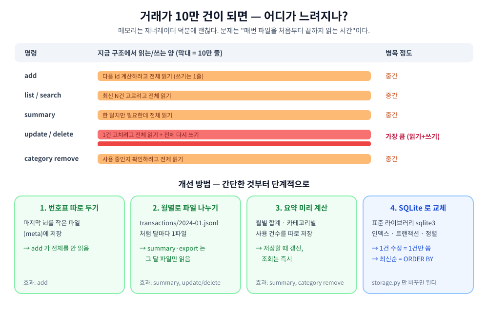
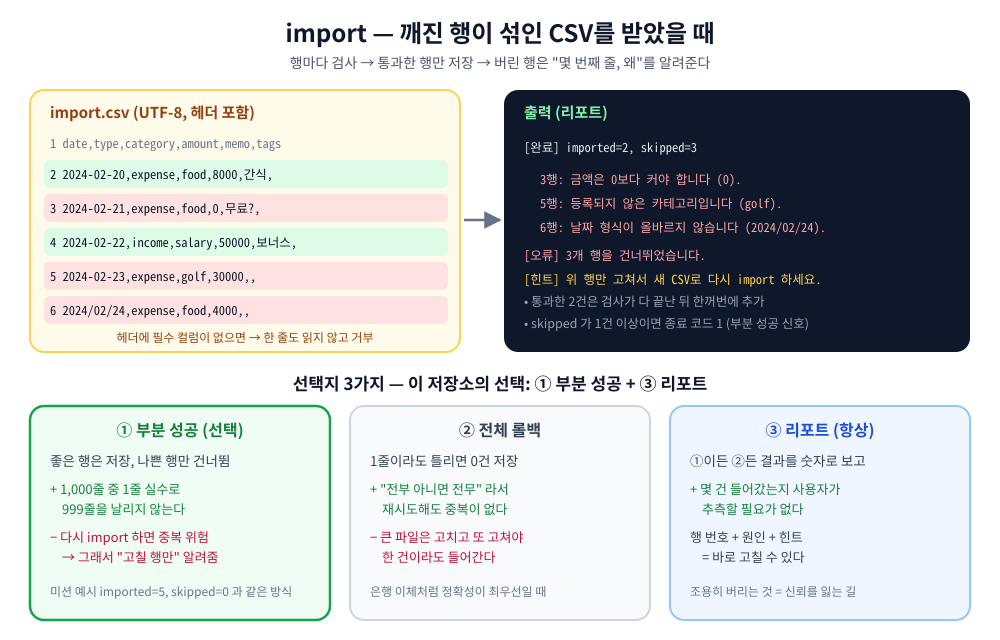

# B2-1 · 나만의 용돈 기입장

> **Python과 Git 심화** · 필수 미션 · 피어평가용 정리

**종이 용돈 기입장을 터미널 프로그램으로 옮기는 과제입니다.** 명령어 한 줄로 기록하고, 찾아보고, 월말에 예산을 넘었는지 확인합니다. 기록은 **JSONL 파일 3개**에 남아 프로그램을 껐다 켜도 그대로입니다.

<p align="center"></p>

> [!NOTE]
> 이 저장소는 B2-1 **개인 미션**의 구현(`budget_app/`, 표준 라이브러리만)과 **피어평가용 정리**입니다. 필수 요구사항만 구현했고 보너스 과제는 하지 않습니다. 아래 결과는 모두 **Python 3.10 실제 실행 출력**입니다.

---

## 🧭 평가 순서 — 위에서 아래로 내려가며 ☐ 를 확인하세요

| 순서 | 섹션 | 평가표 |
|:---:|---|:---:|
| 1 | [실행 준비 · 설계 결정](#1-실행-준비--설계-결정) | — |
| 2 | [먼저 보는 구조 : JSONL · 클래스 설계](#2-먼저-보는-구조--jsonl--클래스-설계) | 항목 2 · 4 |
| 3 | [기능 확인 3-1 ~ 3-12](#3-기능-확인--평가-항목-1) | **항목 1** |
| 4 | [설계 설명 : 안전한 수정 · 제너레이터 · 데코레이터 · 타입 힌트](#4-설계-설명--평가-항목-2--3) | **항목 2 · 3** |
| 5 | [만약에 : 포맷 비교 · 10만 건 · 깨진 CSV](#5-만약에--평가-항목-4) | **항목 4** |
| 6 | [최종 체크리스트](#6-최종-체크리스트) | 전체 |

평가표 항목별 예상 질문과 답 → [`docs/evaluation.md`](docs/evaluation.md)

---

## 1. 실행 준비 · 설계 결정

```bash
python3 --version              # 3.10 이상 (Windows: py -3 --version)
python -m budget_app --help    # 저장소 루트(budget_app/ 이 보이는 곳)에서
```

<details>
<summary><code>--help</code> 결과 보기</summary>

```console
$ python -m budget_app --help
usage: python -m budget_app [-h] [--data-dir DATA_DIR] <명령> ...

나만의 용돈 기입장

positional arguments:
  <명령>
    add                거래 추가 (대화형)
    list               최신순 목록
    search             조건 검색 (최신순)
    summary            월별 요약
    budget             예산 설정
    category           카테고리 관리
    update             거래 수정 (적은 옵션만 바뀜)
    delete             거래 삭제
    import             CSV 가져오기
    export             CSV 내보내기 (기간 필수)

options:
  -h, --help           show this help message and exit
  --data-dir DATA_DIR  저장 폴더 (기본: ./data)
```

</details>

**미션이 "하나를 골라 고정하라"고 한 것 — 이 저장소의 선택**

| 결정 | 선택 |
|---|---|
| 저장 포맷 | **JSONL** (import/export 만 CSV) |
| 저장 위치 | `./data` (`--data-dir` 로 변경) |
| 카테고리가 비었을 때 | **기본 카테고리 자동 생성** — food, transport, rent, salary, etc |
| update 방식 | **옵션 방식** — `update --id … --amount …` |
| 사용 중인 카테고리 삭제 | **삭제 막기** + 옮기는 방법 안내 |
| import 중 깨진 행 | **부분 성공** + 행 번호 리포트 |
| 종료 코드 | 성공 `0` · 실행 오류 `1` · 사용법 오류 `2` |

- [ ] Python 3.10+, **표준 라이브러리만** (pip install 없음)
- [ ] 모든 명령에 `--help`, 옵션은 `--` 표기

---

## 2. 먼저 보는 구조 : JSONL · 클래스 설계

### 2-1. JSONL이란?

<p align="center"></p>

| 왜 JSONL? | 이 과제에서 쓰이는 곳 |
|---|---|
| 한 줄 = 한 건 → **맨 끝에 붙이면 추가 끝** | `add` 는 파일 끝에 한 줄 추가 (3-3) |
| 한 줄씩 읽을 수 있음 → **제너레이터와 딱 맞음** | `list` · `search` · `summary` 스트리밍 (4-2) |
| 숫자 · 목록이 **타입 그대로** | `"amount": 15000`, `"tags": ["meal"]` |

### 2-2. 저장 파일 3개

| 파일 | 담는 것 | 실제 한 줄 |
|---|---|---|
| `data/transactions.jsonl` | 거래 (계속 늘어남) | `{"id": "TX-000001", "type": "expense", "date": "2024-01-03", "amount": 150000, "category": "rent", "memo": "1월 월세", "tags": []}` |
| `data/categories.jsonl` | 카테고리 이름 | `{"name": "food"}` |
| `data/budgets.jsonl` | 월별 예산 (한 달에 1개) | `{"month": "2024-01", "amount": 500000}` |

> 나눈 이유 : 거래는 계속 늘고, 카테고리·예산은 작고 가끔 바뀝니다. 섞어 두면 카테고리 하나 바꿀 때 거래 파일 전체를 다시 써야 합니다.

### 2-3. 클래스 설계

<p align="center"></p>

| 클래스 (파일) | 맡은 일 | 모르는 것 |
|---|---|---|
| `Transaction` (`models.py`) | 거래 한 건의 **모양** (`@dataclass`) | 저장 방법, 화면 |
| `TransactionRepository` (`storage.py`) | `transactions.jsonl` 읽기 · 추가 · 안전한 재작성 | 카테고리가 있는지 |
| `CategoryStore` (`storage.py`) | `categories.jsonl` 이름 목록 | 그 카테고리를 쓰는 거래가 있는지 |
| `BudgetStore` (`storage.py`) | `budgets.jsonl` 월별 예산 | 이번 달에 얼마 썼는지 |
| `BudgetService` (`service.py`) | 입력 검증 + **여러 파일을 함께 봐야 하는 규칙** | 화면 출력, 파일 형식 |
| 명령 함수 11개 (`cli.py`) | `input()` 질문 · `print()` 출력 | 규칙, 파일 형식 |

- **나눈 기준** : "이 코드가 **바뀌는 이유**가 뭐지?" — 화면이 바뀌면 `cli.py`, 규칙이 바뀌면 `service.py`, 파일 형식이 바뀌면 `storage.py`.
- **경계가 보이는 예** : "사용 중인 카테고리는 삭제 금지"는 거래 파일과 카테고리 파일을 **둘 다** 봐야 하므로 `CategoryStore` 가 아니라 `BudgetService` 에 있습니다. (3-10)
- **효과** : JSONL을 다른 형식(예: SQLite)으로 바꿔도 `storage.py` 만 고치면 됩니다.

<details>
<summary>모듈 구성 보기 (7개 파일)</summary>

```
budget_app/
├── __main__.py     # 입구: python -m budget_app → cli.main() 결과를 종료 코드로
├── cli.py          # 명령 함수 11개: argparse, input(), print()
├── service.py      # BudgetService + 입력 검사 함수
├── storage.py      # TransactionRepository · CategoryStore · BudgetStore + atomic_write
├── models.py       # Transaction (@dataclass)
├── decorators.py   # @handle_errors
└── errors.py       # AppError (원인 + 힌트)
```

</details>

- [ ] 모듈 3개 이상으로 나뉘어 있고, 나눈 기준을 설명할 수 있다
- [ ] 클래스 2개 이상의 책임 경계를 설명할 수 있다
- [ ] JSONL이 무엇이고 왜 골랐는지 설명할 수 있다

---

## 3. 기능 확인 — 평가 항목 1

> **빈 상태(`data/` 없음)에서 3-1 → 3-12 순서대로** 실행한 실제 결과입니다. 이미 `data/` 가 있으면 모든 명령에 `--data-dir ./practice` 를 붙여(명령 이름 **앞**) 새 폴더로 따라 하세요.

### 3-1. 처음 실행 — 저장 파일 3개 자동 생성

```console
$ python -m budget_app category list
[안내] 저장 파일을 만들었습니다: data/ (transactions.jsonl, categories.jsonl, budgets.jsonl)
[안내] 카테고리가 비어 있어 기본 카테고리를 등록했습니다: food, transport, rent, salary, etc
- etc
- food
- rent
- salary
- transport

$ ls data
budgets.jsonl  categories.jsonl  transactions.jsonl
```

- [ ] 파일 3개가 생기고, 비어 있는 카테고리는 기본값으로 채워진다

### 3-2. 카테고리 추가 · 목록 — `category add / list`

```console
$ python -m budget_app category add
카테고리명: hobby
[저장 완료] category=hobby

$ python -m budget_app category list
- etc
- food
- hobby
- rent
- salary
- transport

$ python -m budget_app category add
카테고리명: food
[오류] 이미 있는 카테고리입니다 (food).
[힌트] category list 로 목록을 확인하세요.
```

- [ ] 추가 · 목록 동작, 이미 있는 이름은 거부

### 3-3. 거래 추가 — `add` (대화형)

틀린 날짜 · 없는 카테고리 · 숫자가 아닌 금액을 일부러 넣어 봅니다. **틀린 칸만 다시 묻고**, 다 맞으면 저장합니다.

```console
$ python -m budget_app add
날짜(YYYY-MM-DD): 2024-13-40
[오류] 날짜 형식이 올바르지 않습니다 (2024-13-40).
[힌트] YYYY-MM-DD 형식, 예: 2024-01-15
날짜(YYYY-MM-DD): 2024-01-15
타입(income/expense): expense
카테고리: snack
[오류] 등록되지 않은 카테고리입니다 (snack).
[힌트] 등록된 카테고리: etc, food, hobby, rent, salary, transport / 새로 쓰려면 category add
카테고리: food
금액(양수): 만원
[오류] 금액은 정수여야 합니다 (만원).
[힌트] 숫자만 입력하세요. 예: 15000
금액(양수): 15000
메모(선택): 점심
태그(쉼표로 구분, 없으면 엔터): meal
[저장 완료] id=TX-000004
```

<details>
<summary>연습 데이터 6건 (같은 방법으로 입력, 위 화면은 4번째)</summary>

| id | 날짜 | 타입 | 카테고리 | 금액 | 메모 | 태그 |
|---|---|---|---|---|---|---|
| TX-000001 | 2024-01-03 | expense | rent | 150000 | 1월 월세 | |
| TX-000002 | 2024-01-12 | expense | transport | 20000 | 교통카드 충전 | commute |
| TX-000003 | 2024-01-14 | income | salary | 3000000 | 1월 월급 | monthly |
| TX-000004 | 2024-01-15 | expense | food | 15000 | 점심 | meal |
| TX-000005 | 2024-01-20 | expense | food | 30000 | 점심 | meal |
| TX-000006 | 2024-01-20 | expense | food | 30000 | 점심 | meal ← 실수로 중복 (3-7에서 삭제) |

</details>

- [ ] 질문에 차례로 답해 저장되고 **id가 출력**된다
- [ ] 날짜 형식 · 없는 카테고리 · 0 이하/숫자 아닌 금액을 막는다

### 3-4. 목록 — `list`

```console
$ python -m budget_app list --limit 3
TX-000006 | 2024-01-20 | expense | food | 30000 | 점심 | #meal
TX-000005 | 2024-01-20 | expense | food | 30000 | 점심 | #meal
TX-000004 | 2024-01-15 | expense | food | 15000 | 점심 | #meal
```

- [ ] **최신순**(날짜 → 같은 날이면 나중 id), `--limit` 동작 (기본 10)

### 3-5. 검색 — `search`

조건: `--from` `--to` `--category` `--type` `--q`(메모) `--tag` — 여러 개를 주면 **모두 만족(AND)**

```console
$ python -m budget_app search --q 점심
TX-000006 | 2024-01-20 | expense | food | 30000 | 점심 | #meal
TX-000005 | 2024-01-20 | expense | food | 30000 | 점심 | #meal
TX-000004 | 2024-01-15 | expense | food | 15000 | 점심 | #meal

$ python -m budget_app search --from 2024-01-01 --to 2024-01-14 --type expense
TX-000002 | 2024-01-12 | expense | transport | 20000 | 교통카드 충전 | #commute
TX-000001 | 2024-01-03 | expense | rent | 150000 | 1월 월세
```

- [ ] 조건 검색 결과가 최신순으로 나온다

### 3-6. 수정 — `update` (옵션 방식)

```console
$ python -m budget_app update --id TX-000005 --memo "팀 점심" --tags meal,team
[수정 완료] TX-000005 | 2024-01-20 | expense | food | 30000 | 팀 점심 | #meal #team

$ python -m budget_app update --id TX-000005 --amount -5
[오류] 금액은 0보다 커야 합니다 (-5).
[힌트] 양수만 입력하세요. 예: 15000
```

- [ ] 적은 항목만 바뀌고, 바뀐 값도 add와 같은 검사를 받는다

### 3-7. 삭제 — `delete`

```console
$ python -m budget_app delete --id TX-000006
[삭제 완료] id=TX-000006

$ python -m budget_app delete --id TX-000006
[오류] id=TX-000006 거래를 찾을 수 없습니다.
[힌트] list 명령으로 id를 먼저 확인하세요.
```

- [ ] 삭제되고, 없는 id는 "없는 데이터"로 안내한다

### 3-8. 예산 · 월 요약 — `budget set` · `summary`

```console
$ python -m budget_app budget set --month 2024-01 --amount 500000
[저장 완료] 2024-01 예산 500000원

$ python -m budget_app summary --month 2024-01 --top 3
총 수입: 3000000원
총 지출: 215000원
잔액: 2785000원
예산: 500000원 (사용률 43.0%)

지출 TOP 3
1) rent 150000원
2) food 45000원
3) transport 20000원

$ python -m budget_app summary --month 2024-03
[안내] 2024-03 데이터 없음
```

- [ ] 예산이 `budgets.jsonl` 에 저장된다
- [ ] 총수입 · 총지출 · 잔액 · TOP N · **예산 사용률**, 데이터 없는 달 안내

### 3-9. 내보내기 · 가져오기 — `export` · `import`

**CSV 스키마 (고정)** — `date`(Y, YYYY-MM-DD) · `type`(Y, income/expense) · `category`(Y, 등록된 이름) · `amount`(Y, 양수 정수) · `memo`(N) · `tags`(N, 쉼표 구분) / **UTF-8 · 헤더 포함**

```console
$ python -m budget_app export --out jan.csv --month 2024-01
[완료] jan.csv (5 records)

$ cat jan.csv
date,type,category,amount,memo,tags
2024-01-03,expense,rent,150000,1월 월세,
2024-01-12,expense,transport,20000,교통카드 충전,commute
2024-01-14,income,salary,3000000,1월 월급,monthly
2024-01-15,expense,food,15000,점심,meal
2024-01-20,expense,food,30000,팀 점심,"meal,team"

$ python -m budget_app export --out jan.csv
[오류] 내보낼 기간이 없습니다.
[힌트] --month YYYY-MM 또는 --from YYYY-MM-DD --to YYYY-MM-DD 를 지정하세요.
```

[`examples/import_ok.csv`](examples/import_ok.csv)(2월 정상 4건)와 [`examples/import_broken.csv`](examples/import_broken.csv)(5건 중 3건 깨짐)를 가져옵니다.

```console
$ python -m budget_app import --from examples/import_ok.csv
[완료] imported=4, skipped=0

$ python -m budget_app import --from examples/import_broken.csv
[완료] imported=2, skipped=3
  3행: 금액은 0보다 커야 합니다 (0).
  5행: 등록되지 않은 카테고리입니다 (golf).
  6행: 날짜 형식이 올바르지 않습니다 (2024/02/24).
[오류] 3개 행을 건너뛰었습니다.
[힌트] 위 행만 고쳐서 새 CSV로 다시 import 하세요.
```

가져온 2월 데이터로 **예산 초과**를 확인합니다.

```console
$ python -m budget_app budget set --month 2024-02 --amount 150000
[저장 완료] 2024-02 예산 150000원

$ python -m budget_app summary --month 2024-02 --top 3
총 수입: 3050000원
총 지출: 200000원
잔액: 2850000원
예산: 150000원 (사용률 133.3%)
[경고] 예산을 50000원 초과했습니다!

지출 TOP 3
1) rent 150000원
2) transport 30000원
3) food 20000원
```

- [ ] export : UTF-8 · 헤더 · 고정 컬럼, **기간 조건 필수**
- [ ] import : 처리 건수 출력, 깨진 행은 행 번호와 이유
- [ ] 예산을 넘으면 `[경고]`

### 3-10. 카테고리 삭제 — `category remove`

```console
$ python -m budget_app category remove
삭제할 카테고리명: food
[오류] food 카테고리를 사용하는 거래가 4건 있어 삭제할 수 없습니다.
[힌트] update --id <id> --category <다른 카테고리> 로 먼저 옮기세요.

$ python -m budget_app category remove
삭제할 카테고리명: hobby
[삭제 완료] category=hobby
```

- [ ] 쓰는 거래가 있는 카테고리는 삭제를 막는다

### 3-11. 오류와 종료 코드

```console
$ python -m budget_app delete --id TX-999999 ; echo "exit=$?"
[오류] id=TX-999999 거래를 찾을 수 없습니다.
[힌트] list 명령으로 id를 먼저 확인하세요.
exit=1

$ python -m budget_app hello ; echo "exit=$?"
usage: python -m budget_app [-h] [--data-dir DATA_DIR] <명령> ...
python -m budget_app: error: argument <명령>: invalid choice: 'hello' (choose from 'add', 'list', 'search', 'summary', 'budget', 'category', 'update', 'delete', 'import', 'export')
exit=2

$ mkdir -p data_broken && echo '{oops' > data_broken/transactions.jsonl && python -m budget_app --data-dir data_broken list
[안내] 저장 파일을 만들었습니다: data_broken/ (categories.jsonl, budgets.jsonl)
[안내] 카테고리가 비어 있어 기본 카테고리를 등록했습니다: food, transport, rent, salary, etc
[오류] transactions.jsonl 의 1번째 줄이 손상되었습니다.
[힌트] 파일을 열어 그 줄을 고치거나 지운 뒤 다시 실행하세요.
```

| 종료 코드 | 언제 |
|:---:|---|
| `0` | 정상 (저장 완료, 목록, "데이터 없음" 안내) |
| `1` | 실행 중 오류 (없는 id, 잘못된 값, 파일 손상·없음, 사용 중 카테고리, import 일부 건너뜀) |
| `2` | 사용법 오류 (없는 명령, 필수 옵션 누락 — argparse) |

> `echo $?` = 방금 명령의 종료 코드 (Windows PowerShell: `$LASTEXITCODE`)

- [ ] 잘못된 입력 · 파일 오류에서 **스택트레이스 없이** `[오류]` + `[힌트]`
- [ ] 오류면 종료 코드가 0이 아니다

### 3-12. 다시 실행해도 남아 있나

```console
$ ls data
budgets.jsonl  categories.jsonl  transactions.jsonl

$ python -m budget_app list --limit 3
TX-000011 | 2024-02-22 | income  | salary | 50000 | 보너스
TX-000010 | 2024-02-20 | expense | food | 8000 | 간식
TX-000009 | 2024-02-15 | expense | food | 12000 | 점심, 커피 | #meal #cafe
```

- [ ] 프로그램은 명령마다 끝나지만 거래 · 카테고리 · 예산이 그대로 남는다

---

## 4. 설계 설명 — 평가 항목 2 · 3

> 각 주제마다 **한 줄 답** → 그림 → (펼치면) 실제 코드. 평가 때는 한 줄 답부터 말하면 됩니다.

### 4-1. 파일 기반 update / delete를 어떻게 안전하게? `항목 2`

> **한 줄 답** : 원본은 읽기만 하고, **같은 폴더의 임시 파일에 다 쓴 뒤 `os.replace()` 로 한 번에 바꿔 끼웁니다.** 어느 순간 멈춰도 "원본 그대로" 아니면 "완성된 새 파일"만 남습니다.

<p align="center"></p>

<details>
<summary>실제 코드 — <code>storage.py</code> <code>atomic_write()</code> · <code>rewrite()</code></summary>

```python
# 📄 budget_app/storage.py
def atomic_write(path: Path, records: Iterable[dict[str, Any]]) -> None:
    """임시 파일에 전부 쓴 뒤 os.replace로 원본과 한 번에 바꿔 끼운다."""
    fd, tmp = tempfile.mkstemp(dir=path.parent, suffix=".tmp")   # 같은 폴더에 만든다
    try:
        with os.fdopen(fd, "w", encoding="utf-8") as out:
            for record in records:
                out.write(to_line(record))
        os.replace(tmp, path)          # 이 순간에만 원본이 바뀐다
    finally:
        if os.path.exists(tmp):        # 중간에 실패했다면 임시 파일만 지운다
            os.remove(tmp)
```

```python
# 📄 budget_app/storage.py
    def rewrite(self, tx_id: str, new: Transaction | None) -> bool:
        """tx_id 거래를 new로 바꾸거나(update), new가 None이면 뺀다(delete)."""
        if self.find(tx_id) is None:
            return False                       # 없는 id: 파일을 건드리지 않는다

        def updated() -> Iterator[dict[str, Any]]:
            for tx in self.iter_all():         # 원본은 한 줄씩 읽기만 한다
                if tx.id != tx_id:
                    yield tx.to_dict()
                elif new is not None:
                    yield new.to_dict()        # update: 바뀐 거래로 교체
                # delete: 아무것도 내보내지 않으면 그 줄이 빠진다

        atomic_write(self.path, updated())
        return True
```

</details>

- [ ] 원본을 바로 `"w"` 로 열면 왜 위험한지, 임시 파일 + 교체가 왜 안전한지 설명할 수 있다

### 4-2. list / search를 제너레이터로 어떻게? 왜? `항목 3`

> **한 줄 답** : 파일을 한 줄씩 읽어 `yield` 로 한 건씩 넘기고, `heapq.nlargest(N)` · 조건 검사도 그 흐름 위에서 처리합니다. **파일이 커져도 메모리는 "지금 보는 1건 + 결과 N건"** 뿐입니다.

<p align="center"></p>

<details>
<summary>실제 코드 — <code>iter_all()</code> · <code>latest()</code> · <code>search()</code> + 직접 확인</summary>

```python
# 📄 budget_app/storage.py
    def iter_all(self) -> Iterator[Transaction]:
        """거래를 파일 순서대로 한 건씩 내보낸다. 전체를 메모리에 올리지 않는다."""
        for record in read_jsonl(self.path):
            try:
                yield Transaction.from_dict(record)
            except TypeError:
                raise AppError(
                    f"{self.path.name} 에 형식이 맞지 않는 거래가 있습니다: {record}",
                    "필드 이름(id, type, date, amount, category, memo, tags)을 확인하세요.",
                ) from None
```

```python
# 📄 budget_app/service.py
        return heapq.nlargest(limit, self.transactions.iter_all(), key=newest_first)
```

```python
# 📄 budget_app/service.py
        matched: Iterator[Transaction] = (
            tx for tx in self.transactions.iter_all()
            if (start is None or tx.date >= start)
            and (end is None or tx.date <= end)
            and (category is None or tx.category == category)
            and (type_ is None or tx.type == type_)
            and (keyword is None or keyword in tx.memo)
            and (tag is None or tag in tx.tags)
        )
        return sorted(matched, key=newest_first, reverse=True)   # 조건에 맞는 것만 정렬
```

호출만으로는 읽지 않고, `next()` 할 때마다 한 건씩 나옵니다.

```console
$ python -c '
from pathlib import Path
from budget_app.storage import TransactionRepository
gen = TransactionRepository(Path("data")).iter_all()
print(type(gen).__name__)
print(next(gen))
print(next(gen).id)
'
generator
Transaction(id='TX-000001', type='expense', date='2024-01-03', amount=150000, category='rent', memo='1월 월세', tags=[])
TX-000002
```

</details>

- [ ] `yield` 가 어떻게 동작하고, 리스트로 다 읽는 것보다 왜 유리한지 설명할 수 있다

### 4-3. 데코레이터로 무엇을 분리했나? 왜? `항목 3`

> **한 줄 답** : **`@handle_errors`** 로 "오류 → `[오류]`+`[힌트]` 출력 → 종료 코드 1"을 한 곳에 모았습니다. 명령 함수 11개에는 할 일만 남고, 하나라도 빠뜨려 스택트레이스가 새는 일이 없습니다.

<p align="center"></p>

<details>
<summary>실제 코드 — <code>decorators.py</code> · 적용 예</summary>

```python
# 📄 budget_app/decorators.py
def handle_errors(func: Callable[..., None]) -> Callable[..., int]:
    """명령 함수를 감싸서: 성공하면 0, 오류면 [오류]+[힌트]를 출력하고 1을 돌려준다."""

    @functools.wraps(func)                    # 감싼 뒤에도 원래 함수 이름·설명 유지
    def wrapper(*args: Any, **kwargs: Any) -> int:
        try:
            func(*args, **kwargs)
            return 0
        except AppError as e:                 # 예상한 오류: 원인 + 힌트
            show_error(e)
            return 1
        except (EOFError, KeyboardInterrupt):  # 입력 도중 Ctrl+D / Ctrl+C
            print("\n[중단] 입력을 취소했습니다. 아무것도 저장하지 않았습니다.", file=sys.stderr)
            return 1
        except Exception as e:                # 예상 못한 오류도 스택트레이스 대신 안내
            show_error(AppError(f"예상하지 못한 문제가 발생했습니다 ({type(e).__name__}).",
                                "입력값과 data 폴더의 파일을 확인하세요."))
            return 1

    return wrapper
```

```python
# 📄 budget_app/cli.py
@handle_errors
def cmd_delete(args: argparse.Namespace) -> None:
    service = open_service(args)
    service.delete(args.id)
    print(f"[삭제 완료] id={args.id}")
```

</details>

- [ ] 데코레이터로 분리한 공통 기능(오류 처리 · 종료 코드)과 분리한 이유를 설명할 수 있다

### 4-4. 타입 힌트의 이점을 실제 코드로? `항목 3`

> **한 줄 답** : `add()` 는 `amount: int` 라고 약속합니다. `input()` 문자열을 그대로 넘기는 실수를 일부러 만들면 **mypy가 실행 전에 그 줄을 짚어 줍니다.** 검사가 없으면 문자열로 저장된 뒤 나중에 `summary` 에서 터집니다.

<p align="center"></p>

<details>
<summary>실제로 해 본 결과</summary>

`cmd_add` 의 `amount = ask("금액(양수): ", parse_amount)` 를 `amount = input("금액(양수): ")` 로 잘못 고친 경우:

```console
$ python -m mypy budget_app
budget_app/cli.py:65: error: Argument 4 to "add" of "BudgetService" has incompatible type "str"; expected "int"  [arg-type]
Found 1 error in 1 file (checked 8 source files)
```

검사 없이 실행하면 저장은 "성공"하고, 나중에 요약에서 문제가 드러납니다.

```console
$ cat data/transactions.jsonl
{"id": "TX-000001", "type": "expense", "date": "2024-01-15", "amount": "15000", "category": "food", "memo": "점심", "tags": []}
{"id": "TX-000002", "type": "expense", "date": "2024-01-16", "amount": "9000", "category": "food", "memo": "", "tags": []}
$ python -m budget_app summary --month 2024-01
[오류] 예상하지 못한 문제가 발생했습니다 (TypeError).
[힌트] 입력값과 data 폴더의 파일을 확인하세요.
```

원본 코드는 `mypy --strict` 를 통과합니다. (mypy는 개발용 검사 도구라 프로그램 실행에는 필요 없음)

</details>

- [ ] 타입 힌트로 잡히는 실수를 실제 코드 예로 설명할 수 있다

---

## 5. 만약에 — 평가 항목 4

### 5-1. JSONL vs CSV — 왜 JSONL?

> **한 줄 답** : 저장은 **JSONL** — 한 줄 = 한 건이라 추가·스트리밍이 쉽고, 숫자·목록을 그대로 저장합니다. CSV는 엑셀 친화라 **import/export 에만** 씁니다. (그림 → [2-1](#2-1-jsonl이란))

| 기준 | JSONL | CSV |
|---|---|---|
| 숫자 · 목록(`tags`) | 타입 그대로 | 모두 글자 → 직접 변환 |
| 추가 · 한 줄씩 읽기 | 쉬움 | 가능 (메모 속 쉼표·줄바꿈은 따옴표 처리) |
| 엑셀로 보기 · 용량 | 불편 · 큼(키 반복) | **편함 · 작음** |

### 5-2. 거래가 10만 건이면? 병목과 개선

> **한 줄 답** : 메모리는 제너레이터 덕분에 괜찮지만, **매 명령이 파일 전체를 읽고, update/delete는 1건 때문에 10만 줄을 다시 쓰는 것**이 병목입니다. 월별 파일 분할 → 필요하면 SQLite(표준 `sqlite3`)로 바꾸고, 계층을 나눠 두었으니 **`storage.py` 만** 고치면 됩니다.

<details>
<summary>병목 · 개선 그림</summary>

<p align="center"></p>

</details>

### 5-3. import CSV에 깨진 행이 섞이면?

> **한 줄 답** : **부분 성공 + 리포트**. 모든 행을 검사한 뒤 통과한 행만 한꺼번에 저장하고, 버린 행은 **"몇 번째 줄, 왜"** 를 보여 주며 종료 코드 1로 알립니다. 조용히 버리지 않는 것이 신뢰입니다. (실제 결과 → [3-9](#3-9-내보내기--가져오기--export--import))

<p align="center"></p>

- [ ] JSONL/CSV 비교, 10만 건 병목, 깨진 행 처리를 설명할 수 있다

---

## 6. 최종 체크리스트

| 평가표 | 확인할 것 | 위치 |
|---|---|---|
| **항목 1** | add · list · search · summary · export · import · update · delete 동작 | [3-3~3-9](#3-기능-확인--평가-항목-1) |
| | 재실행 후에도 유지 (파일 3개) | [3-1](#3-1-처음-실행--저장-파일-3개-자동-생성) · [3-12](#3-12-다시-실행해도-남아-있나) |
| | category add / list / remove + 사용 중 처리 | [3-2](#3-2-카테고리-추가--목록--category-add--list) · [3-10](#3-10-카테고리-삭제--category-remove) |
| | budget set → summary 사용률 · 초과 | [3-8](#3-8-예산--월-요약--budget-set--summary) · [3-9](#3-9-내보내기--가져오기--export--import) |
| | import / export CSV 스키마 | [3-9](#3-9-내보내기--가져오기--export--import) |
| | 오류 + 힌트, 종료 코드 ≠ 0 | [3-11](#3-11-오류와-종료-코드) |
| **항목 2** | 모듈 3개+ · 클래스 2개+ 책임 경계 | [2-3](#2-3-클래스-설계) |
| | 안전한 update / delete | [4-1](#4-1-파일-기반-update--delete를-어떻게-안전하게-항목-2) |
| **항목 3** | 제너레이터 · 데코레이터 · 타입 힌트 | [4-2](#4-2-list--search를-제너레이터로-어떻게-왜-항목-3) · [4-3](#4-3-데코레이터로-무엇을-분리했나-왜-항목-3) · [4-4](#4-4-타입-힌트의-이점을-실제-코드로-항목-3) |
| **항목 4** | JSONL vs CSV · 10만 건 · 깨진 CSV | [5](#5-만약에--평가-항목-4) |

<details>
<summary>하지 않는 것 (보너스) · 알아둘 동작 · 저장소 구성</summary>

**보너스 제외** : 백업, 반복 내역, 출력 테이블 정렬, 저장 원자성 추가 강화(`fsync`, 파일 잠금). 단, 필수 요구사항인 update/delete 안정성(임시 파일 + 교체)은 4-1 방식으로 충족합니다.

**알아둘 동작** : id는 "지금 있는 가장 큰 번호 + 1"이라 마지막 번호를 지우면 다음 추가 때 그 번호가 다시 쓰입니다. (3-7에서 지운 TX-000006 이 3-9 import 때 다시 쓰임) 저장된 거래끼리는 항상 유일합니다.

```
README.md            ← 이 문서
docs/evaluation.md   ← 평가표 항목별 예상 질문과 답
budget_app/          ← 구현 (모듈 7개)
examples/            ← import 예시 CSV
images/              ← 설명 그림 (SVG)
```

</details>
