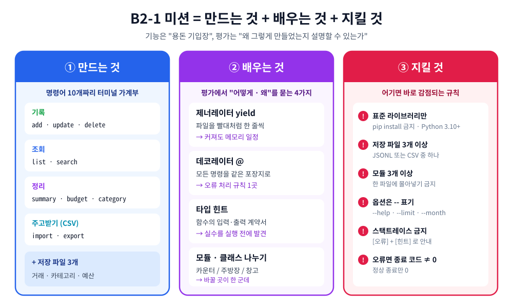
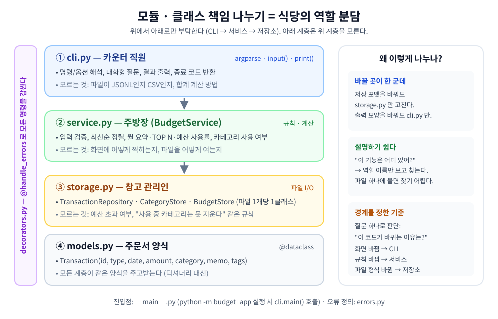
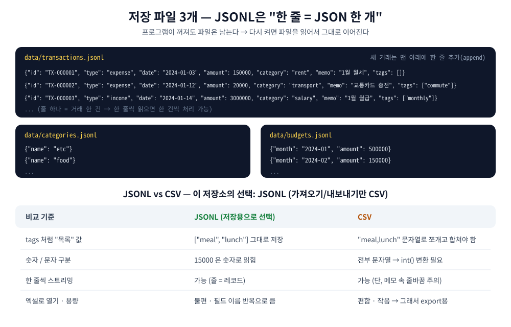
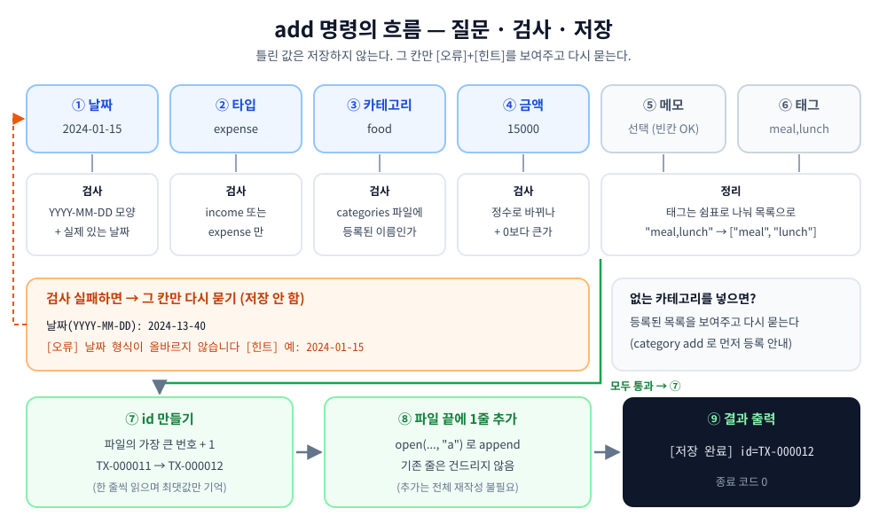
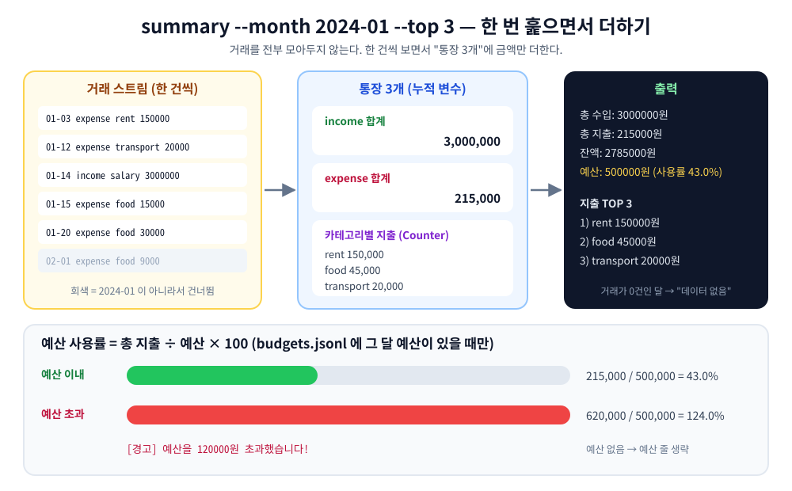
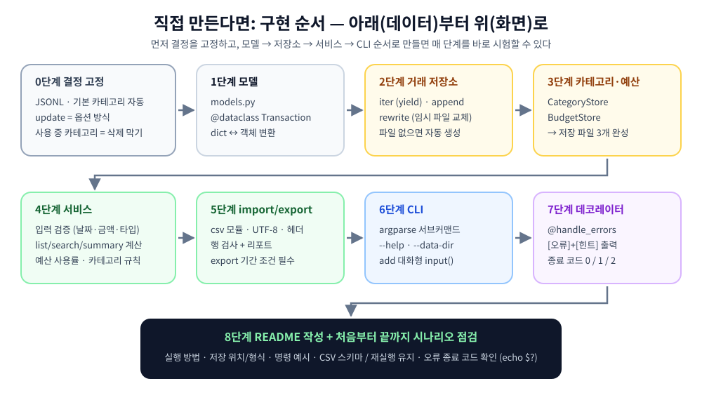

# B2-1 · 나만의 용돈 기입장 프로그램 만들기

> **Python과 Git 심화** · 필수 미션 · 학습시간 60시간

## 💡 이 과제를 한 줄로

### **종이 용돈 기입장을 "터미널 프로그램"으로 옮기는 과제입니다.**

돈을 받거나 쓸 때마다 **명령어 한 줄로 적어 두고**, 필요할 때 **찾아보고**, 월말에 **"얼마 썼고 예산을 넘었는지"** 확인합니다.
기록은 파일에 남아서 프로그램을 껐다 켜도 사라지지 않습니다.

<p align="center"></p>

> [!NOTE]
> B2-1은 **팀 프로젝트**이고, 팀 과제 구현은 소속 팀 저장소에서 진행합니다.
> 이 저장소는 미션을 **기능 하나씩(STEP 1~14) "실행 코드 → 결과 → 내부 코드 → 개념"** 순서로 따라가며 이해하는 **학습·피어평가용 저장소**입니다.
> 결과 화면이 실제와 같도록, 필수 요구사항만 담은 **최소 참고 구현**(`budget_app/`)을 함께 두었습니다. 아래의 모든 결과는 이 구현을 **Python 3.10에서 실제로 실행한 출력**입니다.
> 보너스 과제(백업, 반복 내역, 테이블 정렬, 저장 원자성 강화)는 하지 않습니다.

---

## 📌 목차

| 준비 | 기록하기 | 찾아보기 | 정리하기 | 주고받기 | 지키기 |
|---|---|---|---|---|---|
| [0. 준비하기](#0-준비하기) | [STEP 3. 데이터 입력하기](#step-3-데이터-입력하기--add) | [STEP 4. 목록 보기](#step-4-목록-보기--list) | [STEP 8. 예산 정하기](#step-8-예산-정하기--budget-set) | [STEP 10. 내보내기](#step-10-내보내기--export) | [STEP 12. 카테고리 지우기](#step-12-카테고리-지우기--category-remove) |
| [STEP 1. 처음 실행하기](#step-1-처음-실행하기--저장-파일-3개) | [STEP 6. 고치기](#step-6-고치기--update) | [STEP 5. 찾아보기](#step-5-찾아보기--search) | [STEP 9. 한 달 정리하기](#step-9-한-달-정리하기--summary) | [STEP 11. 가져오기](#step-11-가져오기--import) | [STEP 13. 잘못 썼을 때](#step-13-잘못-썼을-때--오류-메시지와-종료-코드) |
| [STEP 2. 카테고리 만들기](#step-2-카테고리-만들기--category-add--list) | [STEP 7. 지우기](#step-7-지우기--delete) | | | | [STEP 14. 다시 켜도 남아 있나?](#step-14-다시-켜도-남아-있나--마무리-확인) |

부록 : [A. 직접 만든다면 — 구현 순서](#a-직접-만든다면--구현-순서) · [B. 미션 README 필수 4요소 위치](#b-미션-readme-필수-4요소는-어디에) · [C. 하지 않는 것](#c-하지-않는-것-보너스-제외) · **평가 준비 → [`docs/evaluation.md`](docs/evaluation.md)**

### 각 STEP을 읽는 법

| 표시 | 내용 |
|---|---|
| 💻 **실행 코드** | 터미널에 그대로 입력하는 명령 |
| ✅ **결과** | 실제로 나온 화면 (대화형 입력값 포함) |
| 🔍 **내부 코드** | 그 결과를 만든 `budget_app/` 코드 (실제 파일에서 그대로 발췌) |
| 📌 **개념** | 왜 그렇게 만드는지 — 평가표에서 "어떻게 · 왜"를 묻는 부분 |

---

## 0. 준비하기

### 0-1. 미션 한눈에 보기

<p align="center"></p>

| 구분 | 내용 |
|---|---|
| **무엇을** | 터미널에서 쓰는 **가계부(용돈 기입장)** 프로그램 |
| **어떻게 실행** | `python -m budget_app <명령> [옵션]` — 명령 하나 처리하고 끝나는 방식, 모든 명령 `--help` 지원 |
| **입력 방식** | 기본은 **대화형**(`add` 처럼 질문에 답하기), 조회·삭제 등은 **옵션** 방식 |
| **저장** | JSONL 또는 CSV 중 1개로, **파일 3개 이상**에 영구 저장 (transactions / categories / budgets) |
| **꼭 쓰는 도구** | 제너레이터(`yield`), 데코레이터(`@`), 타입 힌트, `dataclass`, 모듈 3개 이상 분리 |
| **제약** | Python 3.10+, **표준 라이브러리만** (pip install 금지), 옵션은 `--` 표기, 스택트레이스 출력 금지 |

### 0-2. 먼저 정해 둔 설계 결정 7가지

미션은 몇 군데에서 **"둘 중 하나를 골라 문서에 고정하라"** 고 요구합니다.

| # | 결정할 것 | 선택지 | **이 저장소의 선택** | 이유 (한 줄) | 나오는 곳 |
|---|---|---|---|---|---|
| 1 | 저장 포맷 | JSONL / CSV | **JSONL** | `tags` 같은 목록과 숫자를 그대로 저장 | STEP 1 |
| 2 | 저장 위치 | `./data` 권장 | **`./data`**, `--data-dir` 로 변경 | 연습용·실사용 가계부를 폴더로 분리 | STEP 1 |
| 3 | 카테고리가 비었을 때 | 안 A 자동 생성 / 안 B add 막기 | **안 A** — `food, transport, rent, salary, etc` | 처음 쓰는 사람이 바로 add 가능 | STEP 1 |
| 4 | update 방식 | 안 A 옵션 / 안 B 대화형 | **안 A 옵션 방식** | 바꿀 항목만 적으면 됨 | STEP 6 |
| 5 | 사용 중인 카테고리 삭제 | 삭제 막기 / 대체 요구 | **삭제 막기** + 힌트 | 데이터가 몰래 바뀌지 않음 | STEP 12 |
| 6 | import 중 깨진 행 | 부분 성공 / 전체 롤백 | **부분 성공 + 행 번호 리포트** | 1줄 실수로 나머지를 버리지 않음 | STEP 11 |
| 7 | 종료 코드 | 0 / 0이 아닌 값 | **0** 성공 · **1** 실행 오류 · **2** 사용법 오류 | 2는 argparse 기본값과 같음 | STEP 13 |

### 0-3. 코드 구조 — 누가 무엇을 맡나

<p align="center"></p>

```
budget_app/
├── __main__.py     # 입구: python -m budget_app → cli.main() 결과를 종료 코드로
├── cli.py          # 카운터 직원: argparse, input(), print()
├── service.py      # 주방장: 입력 검증 + 가계부 규칙 (BudgetService)
├── storage.py      # 창고 관리인: 파일 3개 읽기/쓰기 (TransactionRepository, CategoryStore, BudgetStore)
├── models.py       # 주문서 양식: Transaction (@dataclass)
├── decorators.py   # 포장지: @handle_errors (오류 출력 + 종료 코드)
└── errors.py       # AppError: 원인 + 힌트
```

- **나눈 기준** : "이 코드가 **바뀌는 이유**가 뭐지?" — 화면이 바뀌면 `cli.py`, 규칙이 바뀌면 `service.py`, 파일 형식이 바뀌면 `storage.py`.
- **한 방향으로만 부탁** : CLI → 서비스 → 저장소. 저장소는 CLI가 있는지도 모릅니다. 그래서 JSONL을 다른 형식으로 바꿔도 `storage.py` 만 고치면 됩니다.

### 0-4. 실행 준비

💻 **실행 코드** — 저장소 루트(`budget_app/` 이 보이는 폴더)에서

```bash
python3 --version            # 3.10 이상인지 확인 (Windows는 py -3 또는 python)
python -m budget_app --help
```

✅ **결과**

```console
$ python -m budget_app --help
usage: python -m budget_app [-h] [--data-dir DATA_DIR] <명령> ...

나만의 용돈 기입장

positional arguments:
  <명령>
    add                거래 추가 (대화형)
    list               최신순 목록
    search             조건 검색 (최신순)
    summary            월별 요약
    budget             예산 설정
    category           카테고리 관리
    update             거래 수정 (적은 옵션만 바뀜)
    delete             거래 삭제
    import             CSV 가져오기
    export             CSV 내보내기 (기간 필수)

options:
  -h, --help           show this help message and exit
  --data-dir DATA_DIR  저장 폴더 (기본: ./data)
```

명령마다 `--help` 도 됩니다. (예: `python -m budget_app search --help`)

> 아래 STEP은 **빈 상태(`data/` 폴더 없음)** 에서 순서대로 실행한 기록입니다. 이미 `data/` 가 있다면 `--data-dir ./practice` 처럼 새 폴더를 모든 명령에 붙여서 따라 하세요. (`--data-dir` 은 명령 이름 **앞**에 씁니다)

---

## STEP 1. 처음 실행하기 — 저장 파일 3개

> 🎯 **하는 일** : 처음 실행하면 `data/` 폴더와 저장 파일 3개를 만들고, 카테고리가 비어 있으면 기본 카테고리를 넣습니다.

💻 **실행 코드**

```bash
python -m budget_app category list
ls data
cat data/categories.jsonl
```

✅ **결과**

```console
$ python -m budget_app category list
[안내] 저장 파일을 만들었습니다: data/ (transactions.jsonl, categories.jsonl, budgets.jsonl)
[안내] 카테고리가 비어 있어 기본 카테고리를 등록했습니다: food, transport, rent, salary, etc
- etc
- food
- rent
- salary
- transport

$ ls data
budgets.jsonl  categories.jsonl  transactions.jsonl

$ cat data/categories.jsonl
{"name": "etc"}
{"name": "food"}
{"name": "rent"}
{"name": "salary"}
{"name": "transport"}
```

🔍 **내부 코드** — 모든 명령은 시작할 때 `open_service()` 를 거칩니다.

```python
# 📄 budget_app/cli.py
def open_service(args: argparse.Namespace) -> BudgetService:
    """저장 폴더를 준비하고 서비스를 만든다. 처음 실행이면 안내를 출력한다."""
    data_dir = Path(args.data_dir)
    created = ensure_data_dir(data_dir)
    if created:
        print(f"[안내] 저장 파일을 만들었습니다: {data_dir}/ ({', '.join(created)})")
    service = BudgetService(data_dir)
    if service.ensure_default_categories():
        print("[안내] 카테고리가 비어 있어 기본 카테고리를 등록했습니다: food, transport, rent, salary, etc")
    return service
```

```python
# 📄 budget_app/storage.py
def ensure_data_dir(data_dir: Path) -> list[str]:
    """저장 폴더와 파일 3개가 없으면 빈 파일로 만든다. 새로 만든 파일 이름을 돌려준다."""
    data_dir.mkdir(parents=True, exist_ok=True)
    created = []
    for name in (TRANSACTIONS_FILE, CATEGORIES_FILE, BUDGETS_FILE):
        path = data_dir / name
        if not path.exists():
            path.touch()
            created.append(name)
    return created
```

```python
# 📄 budget_app/service.py
    def ensure_default_categories(self) -> bool:
        """카테고리가 비어 있으면 기본 카테고리를 등록한다(안 A). 등록했으면 True."""
        if self.categories.names():
            return False
        self.categories.save(DEFAULT_CATEGORIES)
        return True
```

📌 **개념 — 영구 저장과 JSONL**

<p align="center"></p>

- **영구 저장** = 프로그램이 꺼져도 남는 곳(파일)에 적어 두는 것. 변수는 프로그램이 끝나면 사라지지만 파일은 남습니다.
- **JSONL** = **한 줄에 JSON 하나**. 줄 하나가 거래 하나라서 "한 줄 읽기 = 한 건 처리"가 됩니다. (→ STEP 4 제너레이터와 잘 맞음)
- **파일을 3개로 나눈 이유** : 거래는 계속 늘고, 카테고리·예산은 작고 가끔 바뀝니다. 섞어 두면 카테고리 하나 바꿀 때 거래 파일 전체를 다시 써야 합니다.
- **CSV는?** 저장은 JSONL, **엑셀과 주고받을 때만 CSV** (STEP 10, 11).

> ✔ 평가 연결 : 항목 1 "재실행 후에도 유지 (저장 파일 3개 이상)" · 항목 4 "JSONL vs CSV"

---

## STEP 2. 카테고리 만들기 — `category add / list`

> 🎯 **하는 일** : 거래를 분류할 이름표(food, rent …)를 추가하고 목록을 봅니다. 이미 있는 이름은 막습니다.

💻 **실행 코드**

```bash
python -m budget_app category add      # 질문에 hobby 입력
python -m budget_app category list
python -m budget_app category add      # 이미 있는 food 입력 → 오류
```

✅ **결과**

```console
$ python -m budget_app category add
카테고리명: hobby
[저장 완료] category=hobby

$ python -m budget_app category list
- etc
- food
- hobby
- rent
- salary
- transport

$ python -m budget_app category add
카테고리명: food
[오류] 이미 있는 카테고리입니다 (food).
[힌트] category list 로 목록을 확인하세요.
```

🔍 **내부 코드**

```python
# 📄 budget_app/service.py
    def add_category(self, name: str) -> str:
        name = name.strip()
        names = self.categories.names()
        if not name:
            raise AppError("카테고리명이 비어 있습니다.", "예: food")
        if name in names:
            raise AppError(f"이미 있는 카테고리입니다 ({name}).", "category list 로 목록을 확인하세요.")
        self.categories.save(names + [name])
        return name
```

```python
# 📄 budget_app/storage.py
class CategoryStore:
    """categories.jsonl 담당: 카테고리 이름 목록."""

    def __init__(self, data_dir: Path) -> None:
        self.path = data_dir / CATEGORIES_FILE

    def names(self) -> list[str]:
        return [record["name"] for record in read_jsonl(self.path)]

    def save(self, names: list[str]) -> None:
        atomic_write(self.path, ({"name": name} for name in sorted(names)))
```

📌 **개념 — 클래스의 책임 경계**

- `CategoryStore` 는 **파일에 이름을 읽고 쓰는 일만** 합니다. "중복이면 안 된다"는 **규칙**은 `BudgetService.add_category()` 가 판단합니다.
- 저장 클래스 3개(`TransactionRepository`, `CategoryStore`, `BudgetStore`)는 **파일 1개 = 클래스 1개**. 여러 파일을 함께 봐야 하는 규칙(예: 사용 중인 카테고리 삭제 금지, STEP 12)은 셋을 모두 아는 `BudgetService` 가 맡습니다.

> ✔ 평가 연결 : 항목 1 "category add/list" · 항목 2 "2개 이상 클래스의 책임 경계"

---

## STEP 3. 데이터 입력하기 — `add`

> 🎯 **하는 일** : 질문에 차례로 답해서 거래 한 건을 저장하고, 만들어진 id를 보여줍니다. 틀린 값은 저장하지 않고 **그 칸만 다시 묻습니다.**

💻 **실행 코드** — 아래 표의 6건을 `add` 로 순서대로 넣습니다. (4번째 건은 일부러 틀린 값도 넣어 봅니다)

```bash
python -m budget_app add
```

| 순서 | 날짜 | 타입 | 카테고리 | 금액 | 메모 | 태그 | 만들어진 id |
|---|---|---|---|---|---|---|---|
| 1 | 2024-01-03 | expense | rent | 150000 | 1월 월세 | (엔터) | TX-000001 |
| 2 | 2024-01-12 | expense | transport | 20000 | 교통카드 충전 | commute | TX-000002 |
| 3 | 2024-01-14 | income | salary | 3000000 | 1월 월급 | monthly | TX-000003 |
| **4** | **2024-01-15** | **expense** | **food** | **15000** | **점심** | **meal** | **TX-000004** ← 아래 화면 |
| 5 | 2024-01-20 | expense | food | 30000 | 점심 | meal | TX-000005 |
| 6 | 2024-01-20 | expense | food | 30000 | 점심 | meal | TX-000006 ← 실수로 두 번 입력 (STEP 7에서 삭제) |

✅ **결과** — 4번째 입력 화면 (틀린 날짜 · 없는 카테고리 · 숫자가 아닌 금액을 차례로 넣어 봄)

```console
$ python -m budget_app add
날짜(YYYY-MM-DD): 2024-13-40
[오류] 날짜 형식이 올바르지 않습니다 (2024-13-40).
[힌트] YYYY-MM-DD 형식, 예: 2024-01-15
날짜(YYYY-MM-DD): 2024-01-15
타입(income/expense): expense
카테고리: snack
[오류] 등록되지 않은 카테고리입니다 (snack).
[힌트] 등록된 카테고리: etc, food, hobby, rent, salary, transport / 새로 쓰려면 category add
카테고리: food
금액(양수): 만원
[오류] 금액은 정수여야 합니다 (만원).
[힌트] 숫자만 입력하세요. 예: 15000
금액(양수): 15000
메모(선택): 점심
태그(쉼표로 구분, 없으면 엔터): meal
[저장 완료] id=TX-000004
```

파일에는 한 줄에 한 건씩 쌓입니다. (4건 입력 후)

```console
$ cat data/transactions.jsonl
{"id": "TX-000001", "type": "expense", "date": "2024-01-03", "amount": 150000, "category": "rent", "memo": "1월 월세", "tags": []}
{"id": "TX-000002", "type": "expense", "date": "2024-01-12", "amount": 20000, "category": "transport", "memo": "교통카드 충전", "tags": ["commute"]}
{"id": "TX-000003", "type": "income", "date": "2024-01-14", "amount": 3000000, "category": "salary", "memo": "1월 월급", "tags": ["monthly"]}
{"id": "TX-000004", "type": "expense", "date": "2024-01-15", "amount": 15000, "category": "food", "memo": "점심", "tags": ["meal"]}
```

<p align="center"></p>

🔍 **내부 코드** ① 질문 → 검사 → 다시 묻기

```python
# 📄 budget_app/cli.py
def ask(prompt: str, parse: Callable[[str], T]) -> T:
    """올바른 값이 들어올 때까지 같은 질문을 다시 한다."""
    while True:
        try:
            return parse(input(prompt))
        except AppError as e:
            show_error(e)
```

```python
# 📄 budget_app/cli.py
@handle_errors
def cmd_add(args: argparse.Namespace) -> None:
    service = open_service(args)
    date = ask("날짜(YYYY-MM-DD): ", parse_date)
    type_ = ask("타입(income/expense): ", parse_type)
    category = ask("카테고리: ", service.check_category)
    amount = ask("금액(양수): ", parse_amount)
    memo = input("메모(선택): ").strip()
    tags = parse_tags(input("태그(쉼표로 구분, 없으면 엔터): "))
    tx = service.add(date, type_, category, amount, memo, tags)
    print(f"[저장 완료] id={tx.id}")
```

② 검사 함수 — 문자열을 받아 **올바른 값으로 바꾸거나 `AppError`** 를 냅니다.

```python
# 📄 budget_app/service.py
def parse_date(text: str) -> str:
    text = text.strip()
    try:
        if not re.fullmatch(r"\d{4}-\d{2}-\d{2}", text):
            raise ValueError
        datetime.strptime(text, "%Y-%m-%d")         # 2024-13-40 같은 없는 날짜도 걸러낸다
    except ValueError:
        raise AppError(f"날짜 형식이 올바르지 않습니다 ({text}).", "YYYY-MM-DD 형식, 예: 2024-01-15") from None
    return text
```

```python
# 📄 budget_app/service.py
def parse_amount(text: str) -> int:
    text = text.strip()
    try:
        amount = int(text)
    except ValueError:
        raise AppError(f"금액은 정수여야 합니다 ({text}).", "숫자만 입력하세요. 예: 15000") from None
    if amount <= 0:
        raise AppError(f"금액은 0보다 커야 합니다 ({text}).", "양수만 입력하세요. 예: 15000")
    return amount
```

③ 저장 — 새 id를 정하고 파일 **맨 끝에 한 줄 추가**합니다. (기존 줄은 건드리지 않음)

```python
# 📄 budget_app/service.py
    def add(self, date: str, type_: str, category: str, amount: int,
            memo: str = "", tags: list[str] | None = None) -> Transaction:
        tx = Transaction(
            id=f"TX-{self.transactions.next_number():06d}",
            type=type_, date=date, amount=amount,
            category=self.check_category(category),
            memo=memo, tags=tags or [],
        )
        self.transactions.append([tx])
        return tx
```

```python
# 📄 budget_app/storage.py
    def next_number(self) -> int:
        """다음 id 번호 = 지금까지 가장 큰 번호 + 1."""
        last = 0
        for tx in self.iter_all():
            last = max(last, int(tx.id.split("-")[1]))
        return last + 1

    def append(self, transactions: list[Transaction]) -> None:
        """파일 맨 끝에 거래를 추가한다. 기존 줄은 건드리지 않는다."""
        with self.path.open("a", encoding="utf-8") as f:
            for tx in transactions:
                f.write(to_line(tx.to_dict()))
```

📌 **개념 ① — 데이터 모델 (`@dataclass`)**

```python
# 📄 budget_app/models.py
@dataclass
class Transaction:
    id: str              # "TX-000001" 형식, 유일
    type: str            # "income" 또는 "expense"
    date: str            # "YYYY-MM-DD"
    amount: int          # 양수
    category: str        # 등록된 카테고리
    memo: str = ""
    tags: list[str] = field(default_factory=list)
```

- 딕셔너리 대신 **정해진 양식**을 쓰면 `tx.amout` 같은 오타를 에디터가 바로 잡고, 모든 계층이 같은 모양을 주고받습니다.
- `tags` 처럼 기본값이 리스트면 `field(default_factory=list)` 를 씁니다. (그냥 `= []` 는 모든 거래가 같은 리스트를 공유하는 실수가 생김)

📌 **개념 ② — 타입 힌트는 "계약서"**

<p align="center"></p>

`input()` 은 **항상 문자열**을 돌려줍니다. 위 `cmd_add` 에서 `ask("금액(양수): ", parse_amount)` 대신 `input("금액(양수): ")` 로 잘못 고쳐 보면:

```console
$ python -m mypy budget_app          # 타입 검사 도구 (개발할 때만 사용, 프로그램 실행에는 필요 없음)
budget_app/cli.py:65: error: Argument 4 to "add" of "BudgetService" has incompatible type "str"; expected "int"  [arg-type]
Found 1 error in 1 file (checked 8 source files)
```

검사 없이 그대로 실행하면 **저장은 "성공"** 하고, 문제는 나중에 터집니다.

```console
$ cat data/transactions.jsonl
{"id": "TX-000001", "type": "expense", "date": "2024-01-15", "amount": "15000", "category": "food", "memo": "점심", "tags": []}
{"id": "TX-000002", "type": "expense", "date": "2024-01-16", "amount": "9000", "category": "food", "memo": "", "tags": []}
$ python -m budget_app summary --month 2024-01
[오류] 예상하지 못한 문제가 발생했습니다 (TypeError).
[힌트] 입력값과 data 폴더의 파일을 확인하세요.
```

→ 타입 힌트(`amount: int`)가 있으면 **실수한 바로 그 줄**을 실행 전에 알려 줍니다. 원본 코드는 `mypy --strict` 검사를 통과합니다.

> ✔ 평가 연결 : 항목 1 "add 동작 · 잘못된 입력 처리" · 항목 3 "타입 힌트 이점을 실제 코드로"

---

## STEP 4. 목록 보기 — `list`

> 🎯 **하는 일** : 최신순으로 거래를 보여 줍니다. `--limit N` 으로 개수를 정합니다(기본 10).

💻 **실행 코드**

```bash
python -m budget_app list --limit 3
python -m budget_app list
python -m budget_app list --limit 0     # 잘못된 값
```

✅ **결과**

```console
$ python -m budget_app list --limit 3
TX-000006 | 2024-01-20 | expense | food | 30000 | 점심 | #meal
TX-000005 | 2024-01-20 | expense | food | 30000 | 점심 | #meal
TX-000004 | 2024-01-15 | expense | food | 15000 | 점심 | #meal

$ python -m budget_app list
TX-000006 | 2024-01-20 | expense | food | 30000 | 점심 | #meal
TX-000005 | 2024-01-20 | expense | food | 30000 | 점심 | #meal
TX-000004 | 2024-01-15 | expense | food | 15000 | 점심 | #meal
TX-000003 | 2024-01-14 | income  | salary | 3000000 | 1월 월급 | #monthly
TX-000002 | 2024-01-12 | expense | transport | 20000 | 교통카드 충전 | #commute
TX-000001 | 2024-01-03 | expense | rent | 150000 | 1월 월세

$ python -m budget_app list --limit 0
[오류] --limit 은 1 이상이어야 합니다 (0).
[힌트] 예: --limit 10
```

> 최신순 기준 : **날짜**가 최근인 것 먼저, 같은 날이면 **id가 큰 것**(나중에 입력한 것) 먼저.

🔍 **내부 코드** — 파일 → 한 줄씩 → 상위 N개

```python
# 📄 budget_app/storage.py
def read_jsonl(path: Path) -> Iterator[dict[str, Any]]:
    """JSONL 파일을 한 줄씩 읽어 딕셔너리를 하나씩 내보낸다(yield)."""
    with path.open(encoding="utf-8") as f:
        for line_no, line in enumerate(f, start=1):
            if not line.strip():
                continue
            try:
                yield json.loads(line)
            except json.JSONDecodeError:
                raise AppError(
                    f"{path.name} 의 {line_no}번째 줄이 손상되었습니다.",
                    "파일을 열어 그 줄을 고치거나 지운 뒤 다시 실행하세요.",
                ) from None
```

```python
# 📄 budget_app/storage.py
    def iter_all(self) -> Iterator[Transaction]:
        """거래를 파일 순서대로 한 건씩 내보낸다. 전체를 메모리에 올리지 않는다."""
        for record in read_jsonl(self.path):
            try:
                yield Transaction.from_dict(record)
            except TypeError:
                raise AppError(
                    f"{self.path.name} 에 형식이 맞지 않는 거래가 있습니다: {record}",
                    "필드 이름(id, type, date, amount, category, memo, tags)을 확인하세요.",
                ) from None
```

```python
# 📄 budget_app/service.py
    def latest(self, limit: int) -> list[Transaction]:
        """최신 limit건. 파일을 흘려보내면서 상위 limit건만 기억한다."""
        if limit <= 0:
            raise AppError(f"--limit 은 1 이상이어야 합니다 ({limit}).", "예: --limit 10")
        return heapq.nlargest(limit, self.transactions.iter_all(), key=newest_first)
```

📌 **개념 — 제너레이터 (`yield`)**

<p align="center"></p>

- **리스트** = 양동이로 물을 **다 퍼온 뒤** 마시기 → 파일이 커질수록 메모리도 커짐
- **제너레이터** = 빨대로 **필요한 만큼씩** 마시기 → 파일이 커져도 메모리는 거의 그대로
- `yield` 는 **일시정지 버튼** : 한 건 넘겨주고 멈췄다가, 다음 건을 달라고 하면 멈춘 곳부터 다시 실행합니다.
- `heapq.nlargest(3, ...)` 는 끝까지 훑되 **상위 3건만** 기억합니다. 전체를 정렬하려면 전체를 메모리에 올려야 하므로 쓰지 않습니다.

직접 확인해 보기 — 호출만으로는 파일을 읽지 않고, `next()` 할 때마다 한 건씩 나옵니다.

```console
$ python -c '
from pathlib import Path
from budget_app.storage import TransactionRepository
gen = TransactionRepository(Path("data")).iter_all()
print(type(gen).__name__)
print(next(gen))
print(next(gen).id)
'
generator
Transaction(id='TX-000001', type='expense', date='2024-01-03', amount=150000, category='rent', memo='1월 월세', tags=[])
TX-000002
```

> ✔ 평가 연결 : 항목 1 "list 최신순" · 항목 3 "제너레이터로 어떻게 스트리밍했고 왜 유리한가"

---

## STEP 5. 찾아보기 — `search`

> 🎯 **하는 일** : 조건에 맞는 거래만 최신순으로 보여 줍니다. 조건을 여러 개 주면 **모두 만족(AND)** 하는 것만.

| 옵션 | 뜻 | 검사 방법 |
|---|---|---|
| `--from`, `--to` | 기간 (양 끝 포함) | `start <= tx.date <= end` (YYYY-MM-DD 문자열은 사전순 = 날짜순) |
| `--category` | 카테고리 | `tx.category == 값` |
| `--type` | income / expense | `tx.type == 값` |
| `--q` | 메모 키워드 | `값 in tx.memo` |
| `--tag` | 태그 | `값 in tx.tags` |

💻 **실행 코드**

```bash
python -m budget_app search --q 점심
python -m budget_app search --from 2024-01-01 --to 2024-01-14 --type expense
python -m budget_app search --tag commute
python -m budget_app search --category hobby
```

✅ **결과**

```console
$ python -m budget_app search --q 점심
TX-000006 | 2024-01-20 | expense | food | 30000 | 점심 | #meal
TX-000005 | 2024-01-20 | expense | food | 30000 | 점심 | #meal
TX-000004 | 2024-01-15 | expense | food | 15000 | 점심 | #meal

$ python -m budget_app search --from 2024-01-01 --to 2024-01-14 --type expense
TX-000002 | 2024-01-12 | expense | transport | 20000 | 교통카드 충전 | #commute
TX-000001 | 2024-01-03 | expense | rent | 150000 | 1월 월세

$ python -m budget_app search --tag commute
TX-000002 | 2024-01-12 | expense | transport | 20000 | 교통카드 충전 | #commute

$ python -m budget_app search --category hobby
[안내] 조건에 맞는 거래가 없습니다.
```

🔍 **내부 코드** — 조건 검사도 **제너레이터 표현식** `( ... for ... if ... )` 으로 흘려보냅니다.

```python
# 📄 budget_app/service.py
    def search(self, start: str | None = None, end: str | None = None,
               category: str | None = None, type_: str | None = None,
               keyword: str | None = None, tag: str | None = None) -> list[Transaction]:
        """모든 조건을 만족(AND)하는 거래를 최신순으로."""
        matched: Iterator[Transaction] = (
            tx for tx in self.transactions.iter_all()
            if (start is None or tx.date >= start)
            and (end is None or tx.date <= end)
            and (category is None or tx.category == category)
            and (type_ is None or tx.type == type_)
            and (keyword is None or keyword in tx.memo)
            and (tag is None or tag in tx.tags)
        )
        return sorted(matched, key=newest_first, reverse=True)   # 조건에 맞는 것만 정렬
```

📌 **개념** — 원본 전체가 아니라 **조건을 통과한 것만** 모아서 정렬합니다. 파일이 10만 건이어도 메모리에 올라오는 건 "검색 결과"뿐입니다.

> ✔ 평가 연결 : 항목 1 "search 동작" · 항목 3 "list/search 스트리밍"

---

## STEP 6. 고치기 — `update`

> 🎯 **하는 일** : `--id` 로 거래를 고릅니다. **적은 옵션만** 바뀌고 나머지는 그대로입니다. (옵션 방식으로 고정 — 결정 #4)
> 쓸 수 있는 옵션 : `--date` `--type` `--category` `--amount` `--memo` `--tags`

💻 **실행 코드**

```bash
python -m budget_app update --id TX-000005 --memo "팀 점심" --tags meal,team
python -m budget_app update --id TX-000005 --amount -5       # 잘못된 값
python -m budget_app update --id TX-000005                   # 바꿀 항목 없음
```

✅ **결과**

```console
$ python -m budget_app update --id TX-000005 --memo "팀 점심" --tags meal,team
[수정 완료] TX-000005 | 2024-01-20 | expense | food | 30000 | 팀 점심 | #meal #team

$ python -m budget_app update --id TX-000005 --amount -5
[오류] 금액은 0보다 커야 합니다 (-5).
[힌트] 양수만 입력하세요. 예: 15000

$ python -m budget_app update --id TX-000005
[오류] 바꿀 항목이 없습니다.
[힌트] 예: update --id TX-000001 --amount 18000
```

🔍 **내부 코드** ① 바뀐 항목만 검사해서 새 거래를 만든다

```python
# 📄 budget_app/service.py
    def update(self, tx_id: str, changes: dict[str, Any]) -> Transaction:
        if not changes:
            raise AppError("바꿀 항목이 없습니다.", "예: update --id TX-000001 --amount 18000")
        old = self.transactions.find(tx_id)
        if old is None:
            raise AppError(f"id={tx_id} 거래를 찾을 수 없습니다.", "list 명령으로 id를 먼저 확인하세요.")
        if "category" in changes:
            changes["category"] = self.check_category(str(changes["category"]))
        new = replace(old, **changes)        # 적은 항목만 바뀐 새 Transaction
        self.transactions.rewrite(tx_id, new)
        return new
```

② 파일을 **안전하게 다시 쓴다**

```python
# 📄 budget_app/storage.py
    def rewrite(self, tx_id: str, new: Transaction | None) -> bool:
        """tx_id 거래를 new로 바꾸거나(update), new가 None이면 뺀다(delete)."""
        if self.find(tx_id) is None:
            return False                       # 없는 id: 파일을 건드리지 않는다

        def updated() -> Iterator[dict[str, Any]]:
            for tx in self.iter_all():         # 원본은 한 줄씩 읽기만 한다
                if tx.id != tx_id:
                    yield tx.to_dict()
                elif new is not None:
                    yield new.to_dict()        # update: 바뀐 거래로 교체
                # delete: 아무것도 내보내지 않으면 그 줄이 빠진다

        atomic_write(self.path, updated())
        return True
```

```python
# 📄 budget_app/storage.py
def atomic_write(path: Path, records: Iterable[dict[str, Any]]) -> None:
    """임시 파일에 전부 쓴 뒤 os.replace로 원본과 한 번에 바꿔 끼운다."""
    fd, tmp = tempfile.mkstemp(dir=path.parent, suffix=".tmp")   # 같은 폴더에 만든다
    try:
        with os.fdopen(fd, "w", encoding="utf-8") as out:
            for record in records:
                out.write(to_line(record))
        os.replace(tmp, path)          # 이 순간에만 원본이 바뀐다
    finally:
        if os.path.exists(tmp):        # 중간에 실패했다면 임시 파일만 지운다
            os.remove(tmp)
```

📌 **개념 — 새로 써서 바꿔 끼우기**

<p align="center"></p>

- 텍스트 파일은 **중간 한 줄만 고칠 수 없습니다** → update/delete는 "전체 다시 쓰기"가 됩니다.
- 원본을 `open(path, "w")` 로 열면 **여는 순간 비워집니다.** 쓰다가 멈추면 데이터가 사라집니다.
- 그래서 **임시 파일에 다 쓴 뒤 `os.replace()` 로 한 번에 교체**합니다. 어느 순간에 멈춰도 "원본 그대로" 또는 "완성된 새 파일" 둘 중 하나만 남습니다.
- 임시 파일을 **같은 폴더**에 만드는 이유 : 다른 디스크면 `os.replace` 가 "이름 바꾸기"로 한 번에 끝나지 않을 수 있습니다.

> ✔ 평가 연결 : 항목 1 "update 동작" · 항목 2 "파일 기반 update/delete를 어떻게 안전하게"

---

## STEP 7. 지우기 — `delete`

> 🎯 **하는 일** : `--id` 거래를 지웁니다. 없는 id면 "없는 데이터"로 안내하고 **파일은 건드리지 않습니다.**

💻 **실행 코드** — STEP 4 목록에서 발견한 중복(TX-000006)을 지웁니다.

```bash
python -m budget_app delete --id TX-000006
python -m budget_app delete --id TX-000006     # 한 번 더 → 이미 없음
```

✅ **결과**

```console
$ python -m budget_app delete --id TX-000006
[삭제 완료] id=TX-000006

$ python -m budget_app delete --id TX-000006
[오류] id=TX-000006 거래를 찾을 수 없습니다.
[힌트] list 명령으로 id를 먼저 확인하세요.
```

🔍 **내부 코드** — STEP 6의 `rewrite()` 를 `new=None` 으로 부르면 그 줄만 빠집니다.

```python
# 📄 budget_app/service.py
    def delete(self, tx_id: str) -> None:
        if not self.transactions.rewrite(tx_id, None):
            raise AppError(f"id={tx_id} 거래를 찾을 수 없습니다.", "list 명령으로 id를 먼저 확인하세요.")
```

📌 **개념** — update와 delete가 **같은 안전한 재작성 함수 하나**를 씁니다. 안전 장치를 한 곳에만 두니 둘 다 똑같이 안전합니다.

> 💡 id는 "지금 있는 거래 중 가장 큰 번호 + 1" 입니다. 그래서 **가장 마지막 번호를 지우면** 그 번호가 다음 추가 때 다시 쓰입니다. (이 예에서는 STEP 11에서 TX-000006 이 2월 월세로 다시 쓰임) 저장된 거래끼리는 항상 유일하므로 미션 조건은 지킵니다. 지운 번호를 절대 재사용하지 않으려면 "마지막 번호"를 따로 저장해야 합니다.

> ✔ 평가 연결 : 항목 1 "delete 동작 · 없는 id 처리"

---

## STEP 8. 예산 정하기 — `budget set`

> 🎯 **하는 일** : 월 예산을 `budgets.jsonl` 에 저장합니다. 같은 달을 다시 정하면 덮어씁니다. 확인은 STEP 9 `summary` 에서.

💻 **실행 코드**

```bash
python -m budget_app budget set --month 2024-01 --amount 500000
python -m budget_app budget set --month 2024-1 --amount 500000      # 잘못된 월 형식
cat data/budgets.jsonl
```

✅ **결과**

```console
$ python -m budget_app budget set --month 2024-01 --amount 500000
[저장 완료] 2024-01 예산 500000원

$ python -m budget_app budget set --month 2024-1 --amount 500000
[오류] 월 형식이 올바르지 않습니다 (2024-1).
[힌트] YYYY-MM 형식, 예: 2024-01

$ cat data/budgets.jsonl
{"month": "2024-01", "amount": 500000}
```

🔍 **내부 코드**

```python
# 📄 budget_app/storage.py
class BudgetStore:
    """budgets.jsonl 담당: 월별 예산 (한 달에 1개)."""

    def __init__(self, data_dir: Path) -> None:
        self.path = data_dir / BUDGETS_FILE

    def all(self) -> dict[str, int]:
        return {record["month"]: record["amount"] for record in read_jsonl(self.path)}

    def get(self, month: str) -> int | None:
        return self.all().get(month)

    def set(self, month: str, amount: int) -> None:
        budgets = self.all()
        budgets[month] = amount                # 같은 달이면 덮어쓴다
        atomic_write(self.path, ({"month": m, "amount": a} for m, a in sorted(budgets.items())))
```

📌 **개념** — 예산 파일은 작아서 "전부 읽고 → 고치고 → 안전하게 다시 쓰기"로 충분합니다. 거래 파일과 **같은 `atomic_write`** 를 씁니다.

> ✔ 평가 연결 : 항목 1 "budget set이 저장되는가"

---

## STEP 9. 한 달 정리하기 — `summary`

> 🎯 **하는 일** : `--month` 의 총수입 · 총지출 · 잔액, 카테고리별 지출 TOP N(`--top`, 기본 3), 예산이 있으면 **사용률과 초과 경고**까지 보여 줍니다.

💻 **실행 코드**

```bash
python -m budget_app summary --month 2024-01 --top 3
python -m budget_app summary --month 2024-03            # 거래가 없는 달
```

✅ **결과**

```console
$ python -m budget_app summary --month 2024-01 --top 3
총 수입: 3000000원
총 지출: 215000원
잔액: 2785000원
예산: 500000원 (사용률 43.0%)

지출 TOP 3
1) rent 150000원
2) food 45000원
3) transport 20000원

$ python -m budget_app summary --month 2024-03
[안내] 2024-03 데이터 없음
```

> 예산을 넘으면 `[경고]` 줄이 추가됩니다 → STEP 11 끝의 2월 요약에서 확인.

<p align="center"></p>

🔍 **내부 코드** ① 한 번 훑으면서 더하기만

```python
# 📄 budget_app/service.py
    def summary(self, month: str, top: int) -> MonthSummary | None:
        """그 달 거래를 한 번 훑으면서 합계만 더한다. 거래가 없으면 None."""
        income = expense = count = 0
        by_category: Counter[str] = Counter()
        for tx in self.transactions.iter_all():
            if not tx.date.startswith(month):
                continue
            count += 1
            if tx.type == "income":
                income += tx.amount
            else:
                expense += tx.amount
                by_category[tx.category] += tx.amount
        if count == 0:
            return None
        return MonthSummary(income, expense, by_category.most_common(top), self.budgets.get(month))
```

② 화면에 찍기 (사용률 · 초과 경고)

```python
# 📄 budget_app/cli.py
    if s.budget is None:
        print("예산: 미설정 (budget set 으로 설정할 수 있습니다)")
    else:
        print(f"예산: {s.budget}원 (사용률 {s.expense / s.budget * 100:.1f}%)")
        if s.expense > s.budget:
            print(f"[경고] 예산을 {s.expense - s.budget}원 초과했습니다!")
```

📌 **개념** — 거래를 모아 두지 않고 **합계 변수 3개(수입, 지출, 카테고리별)** 에 더하기만 합니다. `Counter.most_common(N)` 이 TOP N을 골라 줍니다. 계산(서비스)과 출력(CLI)이 나뉘어 있어서, 출력 문구를 바꿔도 계산 코드는 그대로입니다.

> ✔ 평가 연결 : 항목 1 "summary에서 예산 사용률/초과 여부"

---

## STEP 10. 내보내기 — `export`

> 🎯 **하는 일** : 기간에 맞는 거래를 **엑셀로 열 수 있는 CSV**로 저장합니다. 기간 조건(`--month` 또는 `--from`+`--to`)은 **필수**입니다.

**CSV 스키마 (import / export 공통, 고정)**

| column | required | 설명 |
|---|---|---|
| `date` | Y | `YYYY-MM-DD` |
| `type` | Y | `income` / `expense` |
| `category` | Y | 등록된 카테고리 |
| `amount` | Y | 양수 정수 |
| `memo` | N | 문자열 |
| `tags` | N | 쉼표(`,`) 구분 문자열 — 예: `"meal,team"` |
| **공통** | | **UTF-8**, 첫 줄 **헤더 포함** |

💻 **실행 코드**

```bash
python -m budget_app export --out jan.csv --month 2024-01
cat jan.csv
python -m budget_app export --out jan.csv                 # 기간 없음
```

✅ **결과**

```console
$ python -m budget_app export --out jan.csv --month 2024-01
[완료] jan.csv (5 records)

$ cat jan.csv
date,type,category,amount,memo,tags
2024-01-03,expense,rent,150000,1월 월세,
2024-01-12,expense,transport,20000,교통카드 충전,commute
2024-01-14,income,salary,3000000,1월 월급,monthly
2024-01-15,expense,food,15000,점심,meal
2024-01-20,expense,food,30000,팀 점심,"meal,team"

$ python -m budget_app export --out jan.csv
[오류] 내보낼 기간이 없습니다.
[힌트] --month YYYY-MM 또는 --from YYYY-MM-DD --to YYYY-MM-DD 를 지정하세요.
```

> 태그가 2개면 `"meal,team"` 처럼 따옴표로 감싸집니다. 쉼표가 들어간 값을 `csv` 모듈이 알아서 처리해 줍니다.

🔍 **내부 코드**

```python
# 📄 budget_app/service.py
    def export_csv(self, out: Path, start: str, end: str) -> int:
        """start~end 거래를 CSV로 쓴다(파일 순서대로, 한 건씩). 쓴 건수를 돌려준다."""
        count = 0
        try:
            with out.open("w", encoding="utf-8", newline="") as f:
                writer = csv.DictWriter(f, fieldnames=CSV_COLUMNS)
                writer.writeheader()
                for tx in self.transactions.iter_all():
                    if start <= tx.date <= end:
                        row = {col: getattr(tx, col) for col in CSV_COLUMNS}
                        row["tags"] = ",".join(tx.tags)
                        writer.writerow(row)
                        count += 1
```

📌 **개념**

- `csv.DictWriter` + `encoding="utf-8"` + `newline=""` : 한글·쉼표·줄바꿈이 섞인 메모도 CSV 규칙대로 안전하게 씁니다.
- 내보내기도 **한 건 읽고 → 한 줄 쓰기** 스트리밍입니다. 순서는 저장된 순서(입력 순서) 그대로입니다.
- 저장은 JSONL(목록·숫자 그대로), 주고받기는 CSV(엑셀 친화) — **용도에 맞게 포맷을 나눈 것**입니다.

> ✔ 평가 연결 : 항목 1 "import/export가 명시된 CSV 스키마로"

---

## STEP 11. 가져오기 — `import`

> 🎯 **하는 일** : CSV의 거래를 한 번에 등록합니다. 깨진 행이 섞여 있으면 **통과한 행만 저장**하고, 버린 행은 **"몇 번째 줄, 왜"** 를 알려 줍니다. (결정 #6)

예시 파일 : [`examples/import_ok.csv`](examples/import_ok.csv) (2월 정상 4건) · [`examples/import_broken.csv`](examples/import_broken.csv) (5건 중 3건 깨짐)

💻 **실행 코드**

```bash
python -m budget_app import --from examples/import_ok.csv
python -m budget_app import --from examples/import_broken.csv
python -m budget_app import --from nothing.csv
```

✅ **결과**

```console
$ python -m budget_app import --from examples/import_ok.csv
[완료] imported=4, skipped=0

$ python -m budget_app import --from examples/import_broken.csv
[완료] imported=2, skipped=3
  3행: 금액은 0보다 커야 합니다 (0).
  5행: 등록되지 않은 카테고리입니다 (golf).
  6행: 날짜 형식이 올바르지 않습니다 (2024/02/24).
[오류] 3개 행을 건너뛰었습니다.
[힌트] 위 행만 고쳐서 새 CSV로 다시 import 하세요.

$ python -m budget_app import --from nothing.csv
[오류] nothing.csv 파일이 없습니다.
[힌트] 경로와 파일 이름을 확인하세요.
```

가져온 2월 데이터로 **예산 초과**도 확인해 봅니다.

```console
$ python -m budget_app budget set --month 2024-02 --amount 150000
[저장 완료] 2024-02 예산 150000원

$ python -m budget_app summary --month 2024-02 --top 3
총 수입: 3050000원
총 지출: 200000원
잔액: 2850000원
예산: 150000원 (사용률 133.3%)
[경고] 예산을 50000원 초과했습니다!

지출 TOP 3
1) rent 150000원
2) transport 30000원
3) food 20000원
```

🔍 **내부 코드** — 행마다 검사 → 실패는 리포트에 → **검사가 다 끝난 뒤** 통과한 행만 한꺼번에 추가

```python
# 📄 budget_app/service.py
                good: list[Transaction] = []
                errors: list[str] = []
                for row in reader:
                    try:
                        good.append(Transaction(
                            id="",                       # id는 검사가 끝난 뒤 붙인다
                            date=parse_date(row["date"] or ""),
                            type=parse_type(row["type"] or ""),
                            category=self.check_category(row["category"] or ""),
                            amount=parse_amount(row["amount"] or ""),
                            memo=(row.get("memo") or "").strip(),
                            tags=parse_tags(row.get("tags") or ""),
                        ))
                    except AppError as e:
                        errors.append(f"{reader.line_num}행: {e}")
```

```python
# 📄 budget_app/service.py
        # 검사가 모두 끝난 뒤, 통과한 행만 한꺼번에 추가한다
        number = self.transactions.next_number()
        new_txs = [replace(tx, id=f"TX-{number + i:06d}") for i, tx in enumerate(good)]
        self.transactions.append(new_txs)
        return len(new_txs), errors
```

- 헤더에 필수 컬럼(`date, type, category, amount`)이 없으면 **한 줄도 저장하지 않고** 거부합니다. UTF-8이 아니면 엑셀에서 "CSV UTF-8"로 다시 저장하라고 안내합니다.
- 검사는 `add` 와 **같은 검사 함수**(`parse_date`, `parse_amount` …)를 씁니다. 입력 경로가 달라도 규칙은 하나입니다.
- 건너뛴 행이 있으면 리포트를 보여 준 뒤 **종료 코드 1** 로 끝나 "부분 성공"임을 알립니다.

📌 **개념 — 부분 성공 vs 전체 롤백**

<p align="center"></p>

| 방식 | 장점 | 단점 |
|---|---|---|
| **부분 성공 (선택)** | 1줄 실수로 나머지를 버리지 않음 | 파일 전체를 고쳐서 다시 넣으면 **중복** → 그래서 "고칠 행만" 알려 줌 |
| 전체 롤백 | 다시 넣어도 중복 없음 | 큰 파일은 한 건도 못 넣고 계속 고쳐야 함 |
| 리포트 | 몇 건 들어갔는지 추측할 필요 없음 | — (어느 방식이든 **항상** 필요) |

> ✔ 평가 연결 : 항목 1 "import CSV 스키마" · 항목 4 "깨진 행이 섞이면 어떻게 신뢰를 지키나"

---

## STEP 12. 카테고리 지우기 — `category remove`

> 🎯 **하는 일** : 카테고리를 지웁니다. 그 카테고리를 **쓰는 거래가 있으면 삭제를 막고** 옮기는 방법을 알려 줍니다. (결정 #5)

💻 **실행 코드**

```bash
python -m budget_app category remove     # food 입력 (거래가 있음)
python -m budget_app category remove     # hobby 입력 (거래가 없음)
```

✅ **결과**

```console
$ python -m budget_app category remove
삭제할 카테고리명: food
[오류] food 카테고리를 사용하는 거래가 4건 있어 삭제할 수 없습니다.
[힌트] update --id <id> --category <다른 카테고리> 로 먼저 옮기세요.

$ python -m budget_app category remove
삭제할 카테고리명: hobby
[삭제 완료] category=hobby
```

🔍 **내부 코드**

```python
# 📄 budget_app/service.py
    def remove_category(self, name: str) -> str:
        name = self.check_category(name)
        used = sum(1 for tx in self.transactions.iter_all() if tx.category == name)
        if used:                                              # 사용 중이면 삭제를 막는다
            raise AppError(
                f"{name} 카테고리를 사용하는 거래가 {used}건 있어 삭제할 수 없습니다.",
                "update --id <id> --category <다른 카테고리> 로 먼저 옮기세요.",
            )
        self.categories.save([n for n in self.categories.names() if n != name])
        return name
```

📌 **개념** — 거래 파일과 카테고리 파일을 **둘 다 봐야** 판단할 수 있는 규칙이라서, 저장 클래스가 아니라 `BudgetService` 에 있습니다. (STEP 2의 "책임 경계")

> ✔ 평가 연결 : 항목 1 "category remove — 사용 중인 카테고리 처리"

---

## STEP 13. 잘못 썼을 때 — 오류 메시지와 종료 코드

> 🎯 **하는 일** : 어떤 오류든 **스택트레이스 없이** `[오류] 원인` + `[힌트] 해결 방법` 으로 알려 주고, **0이 아닌 종료 코드**로 끝납니다.

💻 **실행 코드** — `echo $?` 는 방금 명령의 종료 코드를 보여 줍니다. (Windows PowerShell은 `$LASTEXITCODE`)

```bash
python -m budget_app delete --id TX-999999 ; echo "exit=$?"     # 없는 id
python -m budget_app hello ; echo "exit=$?"                      # 없는 명령
python -m budget_app delete ; echo "exit=$?"                     # 필수 옵션 누락
```

✅ **결과**

```console
$ python -m budget_app delete --id TX-999999 ; echo "exit=$?"
[오류] id=TX-999999 거래를 찾을 수 없습니다.
[힌트] list 명령으로 id를 먼저 확인하세요.
exit=1

$ python -m budget_app hello ; echo "exit=$?"
usage: python -m budget_app [-h] [--data-dir DATA_DIR] <명령> ...
python -m budget_app: error: argument <명령>: invalid choice: 'hello' (choose from 'add', 'list', 'search', 'summary', 'budget', 'category', 'update', 'delete', 'import', 'export')
exit=2

$ python -m budget_app delete ; echo "exit=$?"
usage: python -m budget_app delete [-h] --id ID
python -m budget_app delete: error: the following arguments are required: --id
exit=2
```

**파일이 손상됐을 때**도 같은 방식입니다. (연습용 폴더에 깨진 줄을 넣어 봄)

```console
$ mkdir -p data_broken && echo '{oops' > data_broken/transactions.jsonl && python -m budget_app --data-dir data_broken list
[안내] 저장 파일을 만들었습니다: data_broken/ (categories.jsonl, budgets.jsonl)
[안내] 카테고리가 비어 있어 기본 카테고리를 등록했습니다: food, transport, rent, salary, etc
[오류] transactions.jsonl 의 1번째 줄이 손상되었습니다.
[힌트] 파일을 열어 그 줄을 고치거나 지운 뒤 다시 실행하세요.
```

| 종료 코드 | 의미 | 예 |
|---|---|---|
| `0` | 정상 | 저장 완료, 목록 출력, "데이터 없음" 안내 |
| `1` | 실행 중 오류 | 없는 id, 잘못된 값, 파일 손상·없음, 사용 중 카테고리, import 일부 건너뜀 |
| `2` | 사용법 오류 | 없는 명령, 필수 옵션 누락 (argparse가 자동으로 2) |

🔍 **내부 코드** ① 오류 = 원인 + 힌트

```python
# 📄 budget_app/errors.py
class AppError(Exception):
    """예상한 오류. 스택트레이스 대신 [오류]/[힌트] 두 줄로 출력된다."""

    def __init__(self, message: str, hint: str = "") -> None:
        super().__init__(message)
        self.hint = hint
```

② 모든 명령을 감싸는 데코레이터

```python
# 📄 budget_app/decorators.py
def handle_errors(func: Callable[..., None]) -> Callable[..., int]:
    """명령 함수를 감싸서: 성공하면 0, 오류면 [오류]+[힌트]를 출력하고 1을 돌려준다."""

    @functools.wraps(func)                    # 감싼 뒤에도 원래 함수 이름·설명 유지
    def wrapper(*args: Any, **kwargs: Any) -> int:
        try:
            func(*args, **kwargs)
            return 0
        except AppError as e:                 # 예상한 오류: 원인 + 힌트
            show_error(e)
            return 1
        except (EOFError, KeyboardInterrupt):  # 입력 도중 Ctrl+D / Ctrl+C
            print("\n[중단] 입력을 취소했습니다. 아무것도 저장하지 않았습니다.", file=sys.stderr)
            return 1
        except Exception as e:                # 예상 못한 오류도 스택트레이스 대신 안내
            show_error(AppError(f"예상하지 못한 문제가 발생했습니다 ({type(e).__name__}).",
                                "입력값과 data 폴더의 파일을 확인하세요."))
            return 1

    return wrapper
```

③ 명령의 결과(0/1)가 그대로 **종료 코드**가 된다

```python
# 📄 budget_app/cli.py
def main(argv: list[str] | None = None) -> int:
    args = build_parser().parse_args(argv)     # 사용법 오류면 argparse가 종료 코드 2로 끝낸다
    result: int = args.handler(args)
    return result
```

```python
# 📄 budget_app/__main__.py
sys.exit(main())
```

📌 **개념 — 데코레이터 = 포장지**

<p align="center"></p>

- 명령 함수 11개(`cmd_add`, `cmd_list` …)에는 **할 일만** 있고, 위에 `@handle_errors` 한 줄만 붙어 있습니다.
- 오류 처리(공통 관심사)를 포장지로 빼서 **규칙이 한 곳**에 있습니다. 명령마다 `try/except` 를 복붙하면 하나만 빠뜨려도 그 명령에서 스택트레이스가 나옵니다.
- **종료 코드가 중요한 이유** : 다른 프로그램(스크립트·자동화)은 화면 글자를 읽지 않고 **종료 코드로 성공/실패를 판단**합니다.

> ✔ 평가 연결 : 항목 1 "스택트레이스 없이 오류+힌트, 종료 코드 ≠ 0" · 항목 3 "데코레이터로 분리한 공통 기능과 이유"

---

## STEP 14. 다시 켜도 남아 있나? — 마무리 확인

> 🎯 **하는 일** : 프로그램은 명령 하나마다 끝납니다. 그래도 기록이 남아 있는지 다시 확인합니다.

💻 **실행 코드**

```bash
ls data
python -m budget_app list --limit 3
```

✅ **결과**

```console
$ ls data
budgets.jsonl  categories.jsonl  transactions.jsonl

$ python -m budget_app list --limit 3
TX-000011 | 2024-02-22 | income  | salary | 50000 | 보너스
TX-000010 | 2024-02-20 | expense | food | 8000 | 간식
TX-000009 | 2024-02-15 | expense | food | 12000 | 점심, 커피 | #meal #cafe
```

STEP 1~13 의 결과가 모두 파일 3개에 남아 있습니다. (거래 11건 · 카테고리 5개 · 예산 2개월)

### ✅ 처음부터 끝까지 체크리스트

| STEP | 확인할 것 | 결과 |
|---|---|---|
| 1 | 첫 실행에 파일 3개 + 기본 카테고리 | `[안내] 저장 파일을 만들었습니다` |
| 2 | category add / list / 중복 거부 | `[저장 완료] category=hobby` |
| 3 | add 대화형 + 틀린 값 다시 묻기 | `[저장 완료] id=TX-000004` |
| 4 | list 최신순 + `--limit` | 최신 3건 |
| 5 | search 조건 5종 | 조건 맞는 거래만 |
| 6 | update 옵션 방식 + 값 검증 | `[수정 완료] …` |
| 7 | delete + 없는 id | `[삭제 완료]` / `exit=1` |
| 8 | budget set 저장 | `budgets.jsonl` 에 한 줄 |
| 9 | summary 합계 · TOP N · 사용률 · 데이터 없음 | `사용률 43.0%` |
| 10 | export 스키마 + 기간 필수 | `jan.csv (5 records)` |
| 11 | import 부분 성공 + 리포트 + 예산 초과 | `imported=2, skipped=3` / `[경고]` |
| 12 | 사용 중 카테고리 삭제 거부 | `4건 있어 삭제할 수 없습니다` |
| 13 | 오류 + 힌트, 종료 코드 1 / 2 | `exit=1`, `exit=2` |
| 14 | 재실행 후 유지 | 같은 데이터 |

➡️ **평가 질문(어떻게 · 왜 · 만약에)은 [`docs/evaluation.md`](docs/evaluation.md) 에서 이어집니다.** (10만 건일 때의 병목, JSONL vs CSV 비교 등)

---

## 부록

### A. 직접 만든다면 — 구현 순서

<p align="center"></p>

**아래(데이터)부터 위(화면)로** 쌓으면 각 단계를 만든 즉시 `python -c` 로 확인할 수 있습니다. 위의 STEP 1~14 는 "쓰는 순서", 이 그림은 "만드는 순서"입니다.

### B. 미션 README 필수 4요소는 어디에?

| 필수 요소 | 이 문서의 위치 |
|---|---|
| 실행 방법 | [0-4. 실행 준비](#0-4-실행-준비) |
| 저장 파일 위치 / 형식 | [STEP 1](#step-1-처음-실행하기--저장-파일-3개) (`./data`, JSONL 3개, `--data-dir`) |
| 주요 명령 예시 | STEP 1 ~ 13 의 💻 실행 코드 / ✅ 결과 |
| import/export CSV 스키마 | [STEP 10의 스키마 표](#step-10-내보내기--export) |

### C. 하지 않는 것 (보너스 제외)

| 보너스 과제 | 이 저장소 |
|---|---|
| 백업(`backup`) | 하지 않음 |
| 반복 내역(월급·월세 자동 생성) | 하지 않음 |
| 출력 테이블 정렬 | 하지 않음 (`|` 구분 출력으로 충분) |
| 저장 원자성 강화 | 추가 강화(`fsync`, 파일 잠금 등)는 하지 않음. 단, **필수 요구사항**인 "update/delete 안정성(임시 파일 · 원자적 교체 권장)"은 STEP 6의 기본 방식으로 충족 |

### 📁 저장소 구성

```
README.md              ← 지금 이 문서 (STEP 1~14)
docs/evaluation.md     ← 평가표 항목 1~4 정리 (확인 방법 + 예상 질문과 답)
budget_app/            ← 최소 참고 구현 (표준 라이브러리만, 필수 요구사항만)
examples/              ← import 예시 CSV (정상 / 깨진 행 포함)
images/                ← 설명 이미지 (SVG)
```
