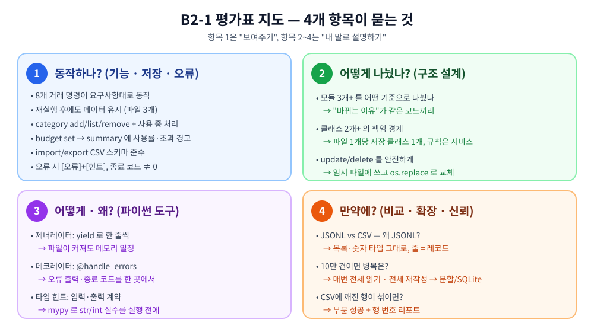

# B2-1 평가표 정리

[← README로 돌아가기](../README.md)

<p align="center"></p>

| 항목 | 묻는 것 | 준비 방법 |
|---|---|---|
| [**항목 1**](#항목-1--동작하나-기능--저장--오류) | 요구사항대로 **동작하나?** | 명령을 직접 실행해서 보여주기 |
| [**항목 2**](#항목-2--어떻게-나눴나-구조-설계) | 구조를 **어떻게** 나눴나? | 모듈·클래스 책임과 안전한 수정/삭제 설명 |
| [**항목 3**](#항목-3--어떻게--왜-파이썬-도구) | 제너레이터·데코레이터·타입 힌트를 **어떻게, 왜** 썼나? | 코드 위치 + 이유를 내 말로 |
| [**항목 4**](#항목-4--만약에-비교--확장--신뢰) | **만약** 조건이 바뀌면? | 비교 근거 + 확장 시나리오 |

> 각 질문은 **한 줄 답 → 쉬운 설명 → 보여줄 코드/명령** 순서로 정리했습니다. 평가 때는 한 줄 답을 먼저 말하고, 꼬리 질문이 오면 아래 설명으로 이어가면 됩니다.
> 코드와 실행 결과는 README의 STEP 1~14 와 저장소의 최소 참고 구현(`budget_app/`)을 기준으로 합니다.

### 어디를 열어 보여주면 되나 (코드 위치)

| 평가에서 묻는 것 | 파일 · 위치 | README |
|---|---|---|
| 제너레이터 (한 줄씩 읽기) | `storage.py` `read_jsonl()` 30행 · `TransactionRepository.iter_all()` 69행 | [STEP 4](../README.md#step-4-목록-보기--list) |
| 제너레이터 위에서 상위 N · 검색 | `service.py` `latest()` 145행 · `search()` 151행 | [STEP 4](../README.md#step-4-목록-보기--list) · [STEP 5](../README.md#step-5-찾아보기--search) |
| 데코레이터 | `decorators.py` `handle_errors()` 11행 → `cli.py` 명령 11개에 `@handle_errors` (56행~) | [STEP 13](../README.md#step-13-잘못-썼을-때--오류-메시지와-종료-코드) |
| 타입 힌트 · dataclass | `models.py` `Transaction` 8행, 모든 함수 시그니처 (`mypy --strict` 통과) | [STEP 3](../README.md#step-3-데이터-입력하기--add) |
| 안전한 update/delete | `storage.py` `atomic_write()` 50행 · `rewrite()` 100행 | [STEP 6](../README.md#step-6-고치기--update) |
| 클래스 책임 경계 | `storage.py` 저장 클래스 3개 · `service.py` `remove_category()` 122행 | [STEP 2](../README.md#step-2-카테고리-만들기--category-add--list) · [STEP 12](../README.md#step-12-카테고리-지우기--category-remove) |
| import 부분 성공 | `service.py` `import_csv()` 222행 | [STEP 11](../README.md#step-11-가져오기--import) |

---

## 항목 1 — 동작하나? (기능 · 저장 · 오류)

> 평가자가 **직접 실행해서 확인**하는 항목입니다. 연습용 폴더(`--data-dir ./data/eval`)를 따로 쓰면 기존 데이터가 섞이지 않습니다.
> 아래 명령은 모두 `python -m budget_app --data-dir ./data/eval` 뒤에 붙인다고 생각하세요.

| # | 체크 항목 | 확인 명령 | 통과 기준 | README |
|---|---|---|---|---|
| 1 | add/list/search/summary/export/import/update/delete 동작 | `add` → `list --limit 5` → `search --type expense` → `update --id ... --amount ...` → `delete --id ...` | 각 명령이 요구한 출력, 목록은 **최신순** | STEP 3~11 |
| 2 | 재실행 후에도 유지 (파일 3개+) | 위 작업 후 다시 `list` · `ls ./data/eval` | 같은 내역 출력, `transactions` / `categories` / `budgets` 3개 파일 존재 | STEP 1, 14 |
| 3 | category add/list/remove + 사용 중 처리 | `category add` → `category list` → 거래가 있는 카테고리로 `category remove` | 추가·목록 정상, **사용 중이면 삭제 거부 + 힌트** | STEP 2, 12 |
| 4 | budget set → summary 사용률·초과 | `budget set --month 2024-02 --amount 150000` → `summary --month 2024-02` | `예산: …원 (사용률 xx.x%)` 줄이 보이고, 100% 넘으면 `[경고]` | STEP 8, 9, 11 |
| 5 | import/export CSV 스키마 | `export --out out.csv --month 2024-02` → 파일 열어 헤더 확인, `import --from examples/import_ok.csv` | UTF-8, 헤더 `date,type,category,amount,memo,tags`, 처리 건수 출력 | STEP 10, 11 |
| 6 | 잘못된 입력/파일 → 오류 + 힌트 | add 에서 날짜 `2024-13-40`, `update --amount -5`, `import --from nothing.csv` | 스택트레이스 **없이** `[오류]` + `[힌트]` | STEP 3, 6, 11, 13 |
| 7 | 오류 시 종료 코드 ≠ 0 | `delete --id TX-999999 ; echo $?` | `1` (사용법 오류는 `2`) | STEP 13 |

<details>
<summary><b>평가자 앞에서 그대로 따라 하는 확인 순서</b> (펼치기)</summary>

```bash
A="python -m budget_app --data-dir ./data/eval"

$A category list                                   # 첫 실행: 파일 3개 생성 + 기본 카테고리
$A import --from examples/import_ok.csv            # [완료] imported=4, skipped=0
$A list --limit 3                                  # 최신순 3건 (TX-000004, 03, 02)
$A search --from 2024-02-01 --to 2024-02-29 --category food
$A budget set --month 2024-02 --amount 150000
$A summary --month 2024-02 --top 3                 # 지출 192000원, 사용률 128.0% + [경고]
$A summary --month 2030-01                         # [안내] 2030-01 데이터 없음
$A update --id TX-000004 --amount 18000            # [수정 완료] …
$A delete --id TX-999999 ; echo "exit=$?"          # [오류]+[힌트], exit=1
$A import --from examples/import_broken.csv ; echo "exit=$?"   # imported=2, skipped=3 + 행 리포트, exit=1
$A category remove                                 # food 입력 → 2건 사용 중이라 거부
$A export --out out.csv --month 2024-02 && head -3 out.csv     # [완료] out.csv (6 records)
$A export --out out.csv ; echo "exit=$?"           # 기간 조건 누락 → 오류, exit=1
ls ./data/eval                                     # 파일 3개 확인 → 다시 list 로 유지 확인
```

</details>

---

## 항목 2 — 어떻게 나눴나? (구조 설계)

<p align="center"></p>

### Q1. 코드를 3개 이상 모듈로 나눈 기준과 각 모듈의 책임은?

**한 줄 답** : **"바뀌는 이유가 같은 코드끼리"** 묶었습니다. 화면은 `cli.py`, 규칙은 `service.py`, 파일은 `storage.py`, 데이터 모양은 `models.py` 입니다.

| 모듈 | 책임 | 이 모듈이 바뀌는 경우 |
|---|---|---|
| `cli.py` | 명령·옵션 해석, `input()` 질문, `print()` 출력, 종료 코드 | 출력 문구나 옵션 이름을 바꿀 때 |
| `service.py` | 입력 검증, 검색 조건, 요약 계산, 예산 사용률, 카테고리 사용 여부 | 가계부 규칙이 바뀔 때 |
| `storage.py` | JSONL 읽기/쓰기, 파일 자동 생성, 안전한 재작성 | 저장 포맷이 바뀔 때 |
| `models.py` | `Transaction` 데이터 모양 | 거래 필드가 늘어날 때 |
| `decorators.py` | 오류 출력·종료 코드 통일 | 오류 출력 규칙이 바뀔 때 |

- **의존 방향은 한 방향** : CLI → 서비스 → 저장소. 저장소는 CLI가 있는지도 모릅니다. 그래서 서비스를 CLI 없이 바로 테스트할 수 있습니다.
- **효과 예시** : "JSONL 대신 SQLite로 바꾸자" → `storage.py` 만 수정. `cli.py`, `service.py` 는 한 줄도 안 바뀝니다.

### Q2. 2개 이상의 클래스에 책임 경계를 어떻게 정했나?

**한 줄 답** : **저장 파일 1개 = 저장 클래스 1개**, 그리고 **여러 파일을 함께 봐야 하는 규칙은 `BudgetService`** 가 맡습니다.

| 클래스 | 아는 것 | 모르는 것 (경계) |
|---|---|---|
| `Transaction` | 거래 한 건의 필드 | 어디에 어떻게 저장되는지 |
| `TransactionRepository` | `transactions.jsonl` 읽기·추가·재작성 | 카테고리가 존재하는지 |
| `CategoryStore` | `categories.jsonl` 의 이름 목록 | 그 카테고리를 쓰는 거래가 있는지 |
| `BudgetStore` | `budgets.jsonl` 의 월별 예산 | 이번 달에 얼마나 썼는지 |
| `BudgetService` | 위 저장소들을 **조합**한 규칙 | 화면 출력, 파일 형식 |

- **경계가 드러나는 예** — "사용 중인 카테고리는 삭제 금지" 규칙은 **어디에?**
  - `CategoryStore` 는 거래 파일을 모르므로 판단할 수 없음
  - → 두 저장소를 모두 아는 `BudgetService.remove_category()` 가 "사용 건수 확인 → 0건이면 `CategoryStore.save()` 로 그 이름을 뺀 목록 저장" ([STEP 12](../README.md#step-12-카테고리-지우기--category-remove))
- "예산 초과 경고"도 같은 이유로 `BudgetService` 에 있습니다 (거래 합계 + 예산 둘 다 필요).

### Q3. 파일 기반 update/delete를 어떻게 안전하게 처리했나?

<p align="center"></p>

**한 줄 답** : 원본은 읽기만 하고, **같은 폴더의 임시 파일에 새 내용을 다 쓴 뒤 `os.replace()` 로 한 번에 교체**합니다. 중간에 멈춰도 원본이 그대로 남습니다.

1. 텍스트 파일은 중간 한 줄만 고칠 수 없다 → 전체 재작성이 필요
2. 원본을 `"w"` 로 열면 그 순간 비워진다 → 쓰다 멈추면 데이터 손실
3. 그래서 **id 먼저 확인(`find`) → 원본 읽기(제너레이터) → 임시 파일 쓰기 → `os.replace` 로 교체**
4. id가 없으면 파일을 아예 건드리지 않고, 쓰는 도중 오류가 나면 `finally` 에서 임시 파일만 지움 → 원본 그대로
5. update와 delete가 **같은 `rewrite()` 하나**를 씀 (`new=None` 이면 delete)

| 멈춘 시점 | 남는 결과 |
|---|---|
| 임시 파일 쓰는 중 | 원본 그대로 (임시 파일은 정리) |
| `os.replace` 이후 | 완성된 새 파일 |
| **"반만 고쳐진 파일"** | **생기지 않음** |

- 코드 : README [STEP 6](../README.md#step-6-고치기--update) (`storage.py` `rewrite()` · `atomic_write()`)
- 꼬리 질문 "왜 같은 폴더에?" → 다른 디스크면 `os.replace` 가 "이름 바꾸기"가 아니라 실패하거나 복사가 되어 한 번에 교체되지 않을 수 있기 때문.
- 꼬리 질문 "add는?" → add는 맨 끝에 한 줄 **추가**(`"a"` 모드)라 기존 줄을 건드리지 않습니다. 재작성 대상이 아닙니다.

---

## 항목 3 — 어떻게 · 왜? (파이썬 도구)

### Q1. list/search를 제너레이터로 어떻게 스트리밍했고, 왜 유리한가?

<p align="center"></p>

**한 줄 답** : 파일을 `for line in f:` 로 한 줄씩 읽어 `yield` 로 한 건씩 넘기고, 조건 검사와 `heapq.nlargest(N)` 도 그 흐름 위에서 처리합니다. **파일이 커져도 메모리는 "지금 보는 1건 + 결과 N건"** 뿐입니다.

```python
# 📄 budget_app/storage.py
    def iter_all(self) -> Iterator[Transaction]:
        """거래를 파일 순서대로 한 건씩 내보낸다. 전체를 메모리에 올리지 않는다."""
        for record in read_jsonl(self.path):
            try:
                yield Transaction.from_dict(record)
            except TypeError:
                raise AppError(
                    f"{self.path.name} 에 형식이 맞지 않는 거래가 있습니다: {record}",
                    "필드 이름(id, type, date, amount, category, memo, tags)을 확인하세요.",
                ) from None
```

```python
# 📄 budget_app/service.py
        return heapq.nlargest(limit, self.transactions.iter_all(), key=newest_first)
```

```python
# 📄 budget_app/service.py
        matched: Iterator[Transaction] = (
            tx for tx in self.transactions.iter_all()
            if (start is None or tx.date >= start)
```

| 비교 | 리스트 (`readlines()`) | 제너레이터 (`yield`) |
|---|---|---|
| 메모리 | 파일 크기만큼 | 거의 일정 |
| 첫 결과까지 | 다 읽어야 시작 | 바로 시작 |
| 코드 연결 | 중간 리스트가 계속 생김 | 읽기 → 필터 → 상위 N 을 파이프처럼 연결 |

- **"어떻게"를 보여주는 법** : `iter_all()` 을 호출만 하고 `type(gen).__name__` → `generator`. `next(gen)` 을 칠 때마다 한 건씩 나오는 것을 시연 ([STEP 4 "직접 확인해 보기"](../README.md#step-4-목록-보기--list)).
- 꼬리 질문 "최신순인데 정렬 안 해도 돼?" → `nlargest` 는 끝까지 훑되 상위 N개만 기억하는 방식(힙)이라 전체 정렬이 필요 없습니다.

### Q2. 데코레이터로 분리한 공통 기능은 무엇이고, 왜 분리했나?

<p align="center"></p>

**한 줄 답** : **`@handle_errors`** — 모든 명령의 "오류 → `[오류]`+`[힌트]` 출력 → 종료 코드 1" 처리를 한 곳에 모았습니다. 명령 함수에는 할 일만 남습니다.

- **분리 전 문제** : 명령 함수 11개에 같은 `try/except` 를 복붙 → 하나라도 빠뜨리면 그 명령만 스택트레이스 노출, 문구 바꿀 때 11곳 수정.
- **분리 후** : 규칙이 1곳. 새 명령은 `@handle_errors` 한 줄로 같은 규칙을 따름. 명령 코드가 짧아져 읽기 쉬움.
- `functools.wraps` 를 쓰는 이유 : 감싼 뒤에도 원래 함수 이름(`cmd_add`)과 docstring이 유지되어 `--help`·디버깅에서 헷갈리지 않음.
- 같은 방식으로 `@timed`(실행 시간 측정)도 붙일 수 있음 — "공통 관심사는 포장지로"라는 같은 원리. (이 저장소는 필수 1개만 구현)
- 코드 : README [STEP 13](../README.md#step-13-잘못-썼을-때--오류-메시지와-종료-코드)

### Q3. 타입 힌트의 이점을 실제 코드로 어떻게 확인했고, 왜 도움이 되나?

<p align="center"></p>

**한 줄 답** : `cmd_add` 에서 금액을 `ask(…, parse_amount)` 대신 `input()` 그대로 넘기는 실수를 일부러 만들어, **mypy 가 실행 전에 그 줄을 지적**하는 것을 확인했습니다. 검사 없이 실행하면 `"amount": "15000"` 이 문자열로 저장되고, 나중에 `summary` 에서야 `TypeError` 가 납니다.

```console
$ python -m mypy budget_app
budget_app/cli.py:65: error: Argument 4 to "add" of "BudgetService" has incompatible type "str"; expected "int"  [arg-type]
```

| 이점 | 실제 코드에서 |
|---|---|
| **계약이 보인다** | `def summary(self, month: str, top: int) -> MonthSummary \| None` — CLI와 서비스가 주고받는 것이 시그니처에 보임 |
| **None 실수 방지** | `def find(self, tx_id: str) -> Transaction \| None` — 없는 id 처리를 빼먹고 `.amount` 를 쓰면 경고 |
| **에디터 도움** | `tx.` 을 치면 `date`, `amount` … 자동완성, 오타(`tx.amout`) 경고 |

- 전체 과정과 실제 출력 : README [STEP 3 개념 ②](../README.md#step-3-데이터-입력하기--add)

- 꼬리 질문 "타입 힌트가 틀리면 실행이 막히나?" → **아니요.** Python은 실행 중 타입을 강제하지 않습니다. 그래서 진짜 값 검증(`int()` 변환, 양수 검사)은 서비스에서 **따로** 합니다. 타입 힌트는 "개발자의 실수", 입력 검증은 "사용자의 실수"를 잡습니다.

---

## 항목 4 — 만약에? (비교 · 확장 · 신뢰)

### Q1. JSONL과 CSV의 장단점과, 왜 그 포맷을 골랐나?

<p align="center"></p>

**한 줄 답** : **저장은 JSONL**을 골랐습니다. `tags` 같은 **목록**과 `amount` 같은 **숫자 타입**을 변환 없이 그대로 저장할 수 있고, 한 줄 = 한 건이라 스트리밍과 잘 맞기 때문입니다. CSV는 사람이 보기 편해서 **import/export 에만** 씁니다.

| 기준 | JSONL | CSV |
|---|---|---|
| 목록 값 (`tags`) | `["meal","lunch"]` 그대로 | `"meal,lunch"` 문자열 → 쪼개기/합치기 필요 |
| 숫자 | 숫자로 읽힘 | 전부 문자열 → `int()` 필요 |
| 필드 추가 | 새 키만 넣으면 됨 (옛 줄은 기본값) | 헤더·모든 행 열 개수 맞춰야 함 |
| 스트리밍 | 줄 = 레코드 | 가능, 단 메모 속 줄바꿈은 따옴표 처리 필요 |
| 사람이 보기 · 엑셀 | 불편 | **편함** |
| 용량 | 키 이름이 매 줄 반복 → 큼 | 작음 |

- **결론** : "프로그램이 읽고 쓰는 저장소"에는 구조를 지키는 JSONL, "사람과 주고받는 파일"에는 CSV.

### Q2. 거래가 10만 건이면 병목은 어디고, 어떻게 개선하나?

<p align="center"></p>

**한 줄 답** : 메모리는 제너레이터 덕분에 괜찮지만, **모든 명령이 매번 파일 전체를 읽고, update/delete는 1건 때문에 10만 줄을 다시 쓰는 것**이 병목입니다. 월별 파일 분할 → 최종적으로 SQLite(표준 라이브러리 `sqlite3`)로 바꾸면 해결되고, **계층을 나눠 두었기 때문에 `storage.py` 만 바꾸면 됩니다.**

| 병목 | 원인 | 개선 (간단한 것부터) |
|---|---|---|
| update / delete | 1건 수정에 전체 읽기 + 전체 쓰기 | 월별 파일 분할 → 그 달 파일만 재작성 / SQLite면 1건만 수정 |
| summary · export | 한 달치만 필요한데 전체 읽기 | 월별 파일 분할 → 그 달 파일만 읽기 |
| add 의 id 발급 | 최댓값 찾으려고 전체 읽기 | 마지막 번호를 작은 메타 파일에 저장 (지운 번호 재사용도 함께 해결) |
| category remove | 사용 여부 확인에 전체 읽기 | 카테고리별 사용 건수를 따로 유지 / SQLite 인덱스 |
| list / search | 최신 N건 찾으려고 전체 읽기 | SQLite `ORDER BY date DESC LIMIT N` + 인덱스 |

- 꼬리 질문 "지금 구조는 몇 건까지 괜찮나?" → 개인 용돈 기입장(연 수백~수천 건)은 전체 읽기로 충분합니다. **측정 없이 미리 복잡하게 만들지 않는 것**도 설계 판단입니다.

### Q3. import CSV에 깨진 행이 섞이면 어떻게 처리해 신뢰를 지키나?

<p align="center"></p>

**한 줄 답** : **부분 성공 + 리포트** 입니다. 모든 행을 먼저 검사하고, 통과한 행만 한꺼번에 저장한 뒤, 버린 행은 **"몇 번째 줄, 왜"** 를 보여줍니다. 조용히 버리지 않는 것이 신뢰의 핵심입니다.

| 단계 | 처리 |
|---|---|
| 1. 파일 확인 | 파일 없음 / UTF-8 아님 / **필수 헤더 누락** → 한 줄도 저장하지 않고 오류 (파일 자체가 잘못됨) |
| 2. 행 검사 | 날짜 형식, type, 등록된 카테고리, 양수 정수 금액 — 행마다 검사해서 통과/실패 목록으로 분리 |
| 3. 저장 | 검사가 **다 끝난 뒤** 통과한 행만 한꺼번에 추가 (검사 도중에 일부만 들어가는 상황 방지) |
| 4. 리포트 | `imported=2, skipped=3` + 실패 행 번호·원인 + 힌트, skipped ≥ 1 이면 종료 코드 1 |

| 선택지 | 장점 | 단점 | 언제 |
|---|---|---|---|
| **부분 성공 (선택)** | 1줄 실수로 999줄을 버리지 않음 | 고친 파일 전체를 다시 넣으면 **중복** 위험 | 개인 가계부처럼 대부분 맞고 일부만 틀릴 때 |
| 전체 롤백 | 재시도해도 중복 없음, 결과가 명확 | 큰 파일은 한 건도 못 넣고 계속 고쳐야 함 | 송금처럼 "전부 아니면 전무"가 중요할 때 |
| 리포트 | 몇 건 들어갔는지 추측할 필요 없음 | — | **어느 방식이든 항상** |

- 꼬리 질문 "중복은 어떻게 막나?" → 리포트에 **실패한 행만** 알려 주므로 사용자는 그 행만 고쳐 다시 넣으면 됩니다. (자동 중복 감지는 이번 범위 밖)
- 코드와 실제 출력 : README [STEP 11](../README.md#step-11-가져오기--import)

---

## ✅ 평가 전 마지막 점검

- [ ] README에 **실행 방법 · 저장 위치/형식 · 명령 예시 · CSV 스키마** 4가지가 있다 (→ README [부록 B](../README.md#b-미션-readme-필수-4요소는-어디에))
- [ ] 설계 결정 7가지(포맷, 카테고리 정책, update 방식 …)를 README [0-2](../README.md#0-2-먼저-정해-둔-설계-결정-7가지)에서 바로 보여줄 수 있다
- [ ] `echo $?` 로 오류 시 종료 코드 1을 보여줄 수 있다
- [ ] 제너레이터 / 데코레이터 / 타입 힌트가 **어느 파일 몇 번째 줄**에 있는지 바로 연다 (→ 위 [코드 위치 표](#어디를-열어-보여주면-되나-코드-위치))
- [ ] 항목 2~4 질문 9개에 **한 줄 답**을 먼저 말할 수 있다

[← README로 돌아가기](../README.md)
